# LCA Explorer

LCA Explorer is a visual interface to explore your LCA projects. It is similar to Activity Browser, with a few
features I missed when I was an LCA analyst using SimaPro. Now that building software is easy using AI, I
wanted to try building my dream tool.

Anyone can use it by cloning this repository on their own machine. No data is stored online: it only touches
your Brightway (v2.5) project folder.

- **Explore** process trees as a list, a tree or a Sankey diagram.
- **Understand** contributions by grouping or merging processes into "abstract" processes: you define *rules* on
  processes and elementary flows, and the contributions follow your own model structure.
- **Compare** processes (the *Compare* mode).
- **Manage** Brightway projects and databases.

## Features

- A database is fully precalculated on all preloaded methods: contribution analysis of any dataset on any
  method is instant.
- Explore the process trees in list view, tree view and Sankey view.
- Understand contributions by grouping or merging processes into "abstract" processes, e.g. break down a
  global market food product per contributing transports, electricity input and fertiliser production.
- Define rules (quick groups, your own from a query or a field) on processes and elementary flows to declutter
  complex supply chains, with colours and palettes; rules live in rule sets shared by all your tabs, with an
  attribution rule (first match or direct) for the contributions.
- Custom view, process contribution, flow contribution and rules contribution analyses; the method names in the
  results are yours to format.
- Find alternative producers of the same product.
- Find processes with complex filters (location, CPC codes, etc., with helpers listing the values).
- Split screens and tabs to keep several process views side by side (a tab shows the panels of a process: its
  tree, who uses it, its alternatives, its description); save and load the views you like.
- Manage Brightway projects and databases.
- Load any database: ecoSpold2, SimaPro CSV, or with your ecoinvent credentials.
- Compare processes intuitively: contributions, cascade (what makes the difference, step by step) and a
  multi indicator matrix.
- Create and edit processes in your project.

## Gallery

<table>
<tr>
<td width="50%"><a href="docs/img/gallery/01-process-tree.png">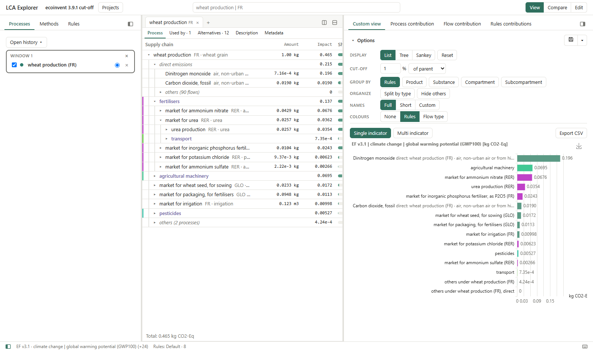</a><br><b>Custom view</b>: the expandable tree with the groups of your rules in colour, the view options, and the chart of what the tree shows.</td>
<td width="50%"><a href="docs/img/gallery/02-sankey.png">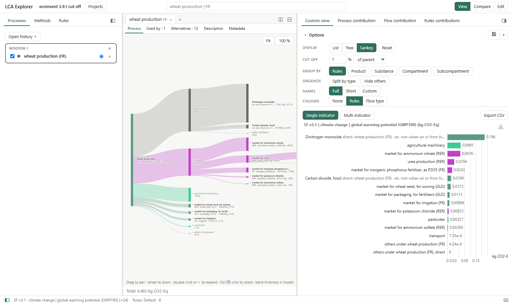</a><br><b>Sankey view</b>: band thickness is proportional to impact.</td>
</tr>
<tr>
<td><a href="docs/img/gallery/03-tree-graph.png">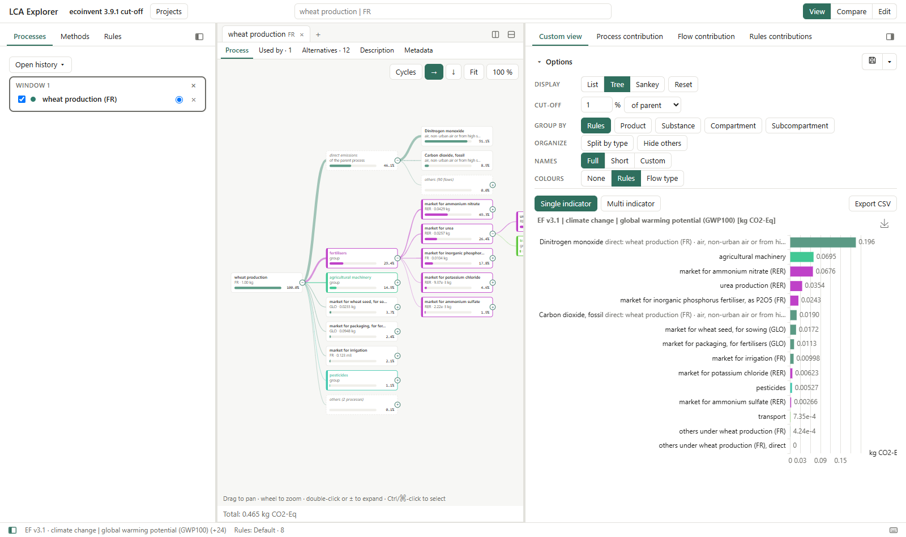</a><br><b>Tree view</b>: the supply chain as nodes and edges.</td>
<td><a href="docs/img/gallery/04-rules.png">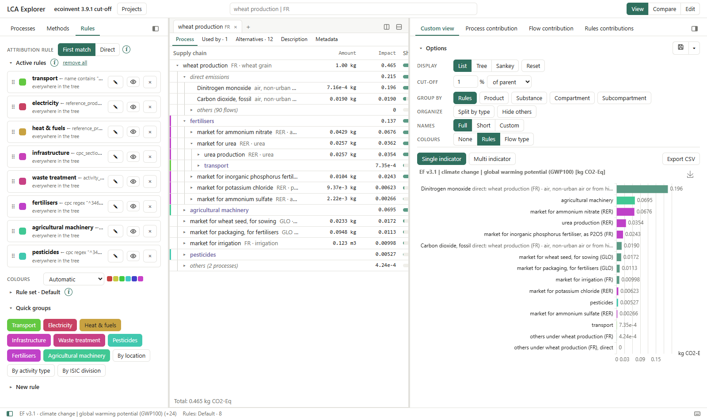</a><br><b>Rules</b>: the attribution rule, the active rules, quick groups, and your own rules from a query or a field.</td>
</tr>
<tr>
<td><a href="docs/img/gallery/05-rules-contributions.png">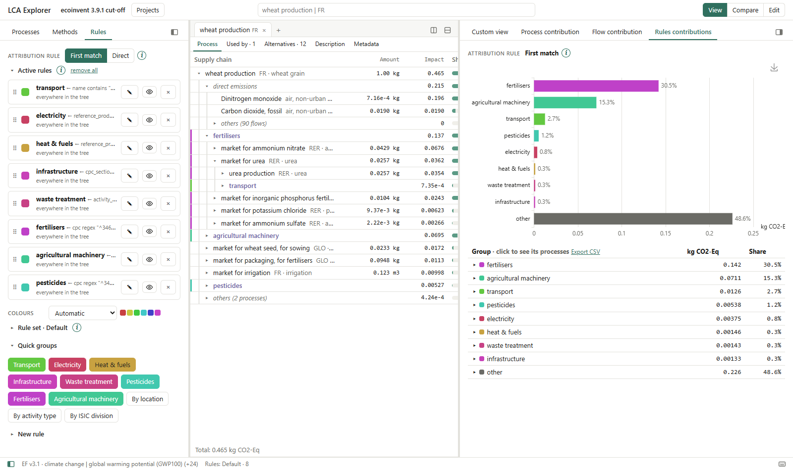</a><br><b>Rules contributions</b>: how much electricity, transport, fertilisers... anywhere upstream, by your rules.</td>
<td><a href="docs/img/gallery/06-flow-contribution.png">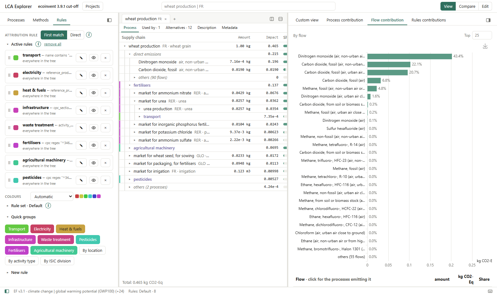</a><br><b>Flow contribution</b>: the score split by elementary flow, by substance, compartment or subcompartment.</td>
</tr>
<tr>
<td><a href="docs/img/gallery/07-search-filters.png">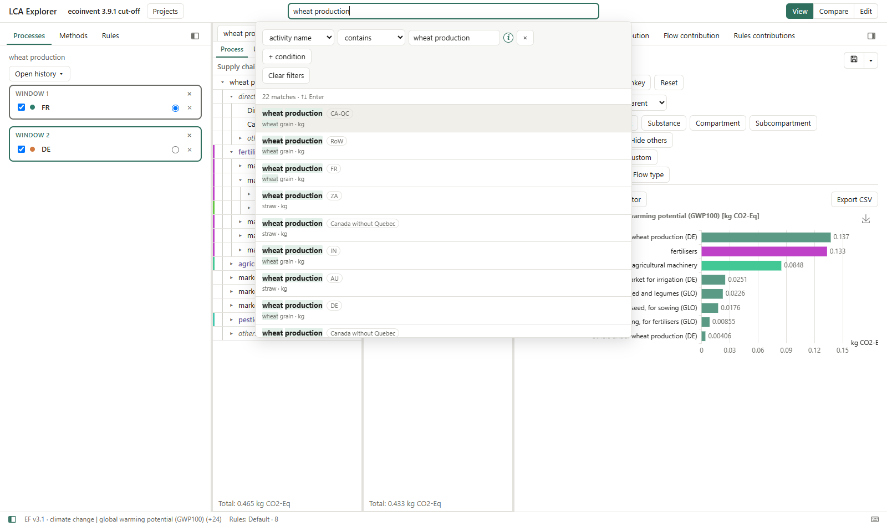</a><br><b>Search with filters</b>: location, CPC and ISIC codes... the (i) lists the values, with names for the codes.</td>
<td><a href="docs/img/gallery/08-alternatives.png">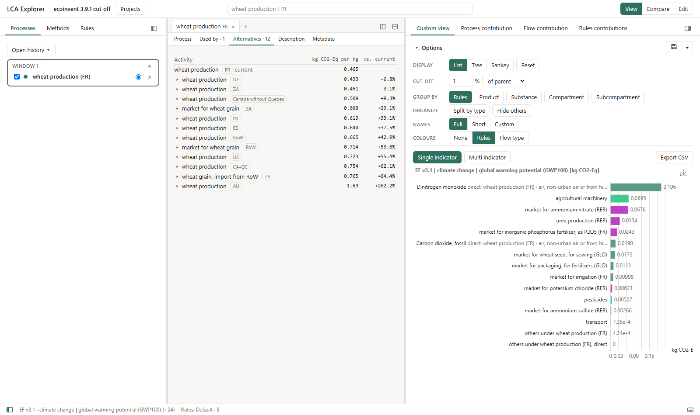</a><br><b>Alternative producers</b>: the panels of a process (tree, used by, alternatives, description, metadata) are the first line of its tab, and of its pop-up (right-click a process).</td>
</tr>
<tr>
<td><a href="docs/img/gallery/09-split-views.png">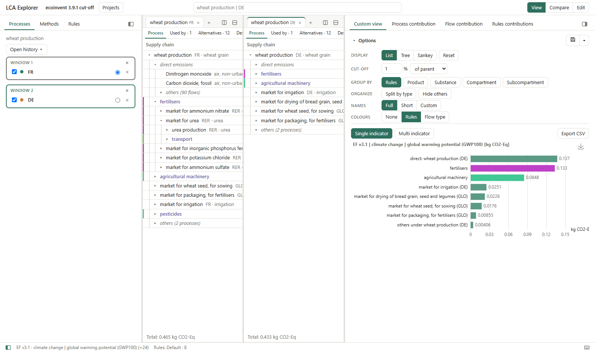</a><br><b>Split screens and tabs</b>: several process views at once, one rule set for all; save and load views.</td>
<td><a href="docs/img/gallery/10-compare.png">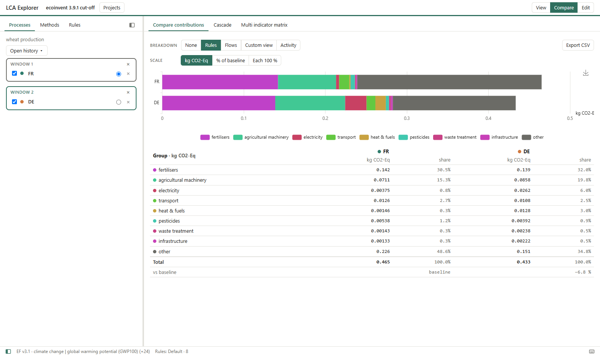</a><br><b>Compare contributions</b>: several processes side by side, broken down by rule, flow, custom view or activity.</td>
</tr>
<tr>
<td><a href="docs/img/gallery/11-compare-difference.png">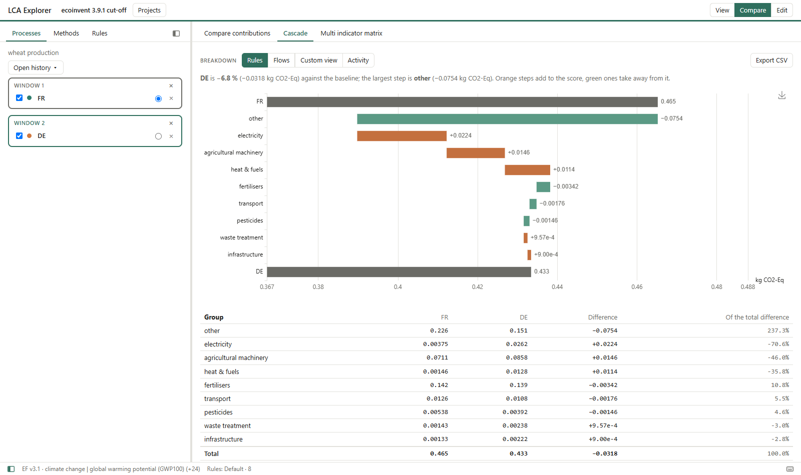</a><br><b>Cascade</b>: what makes one process differ from another, step by step.</td>
<td><a href="docs/img/gallery/12-load-database.png">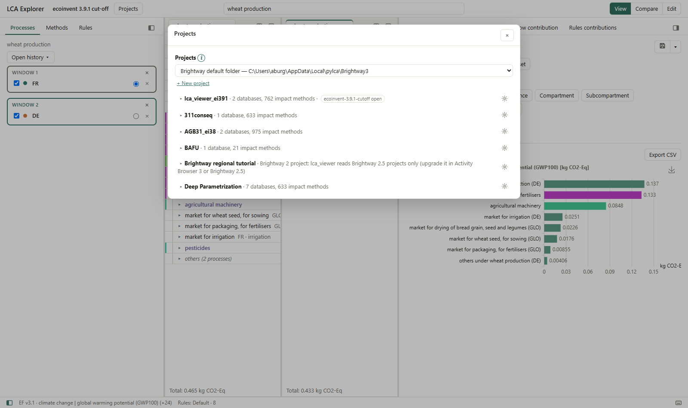</a><br><b>Projects</b>: the databases of your Brightway projects, most recent first.</td>
</tr>
<tr>
<td><a href="docs/img/gallery/13-add-database.png">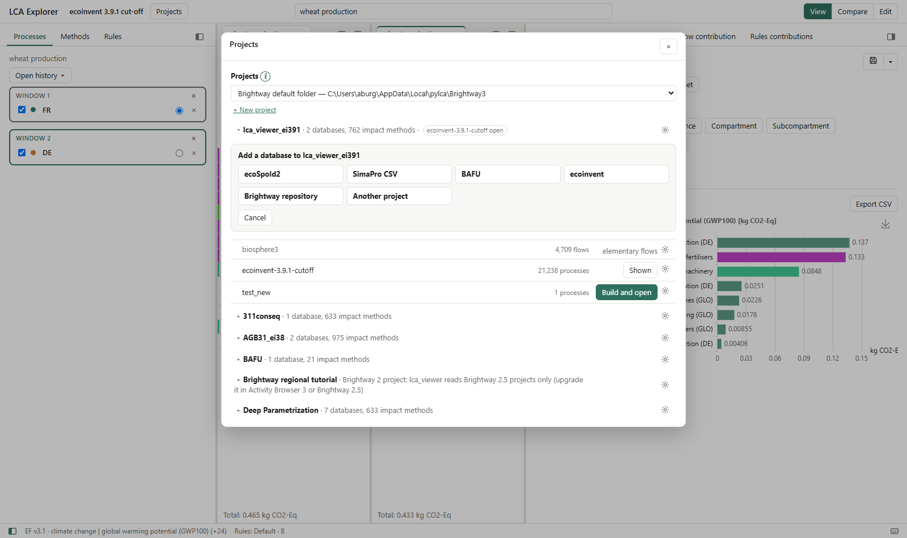</a><br><b>Add a database</b> to a project: from ecoSpold2, SimaPro CSV, ecoinvent or the Brightway repository.</td>
<td><a href="docs/img/gallery/14-new-process.png">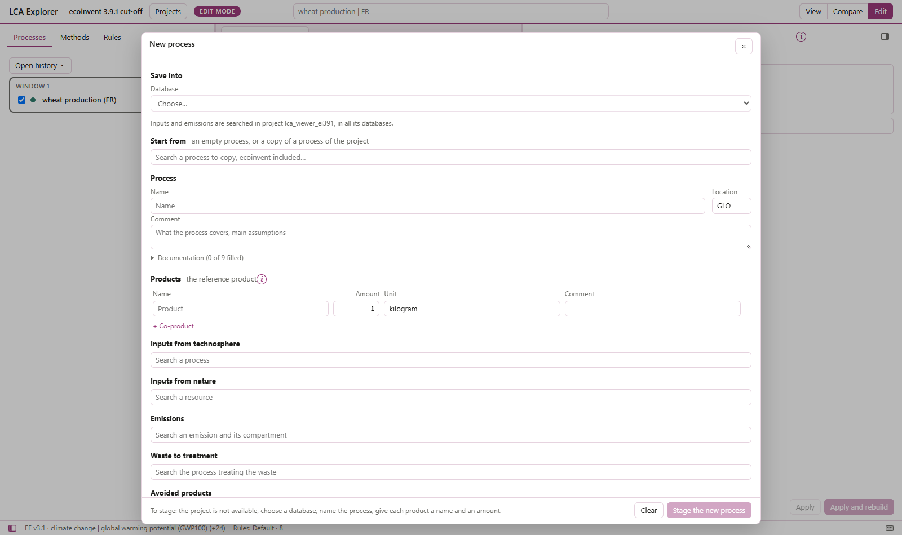</a><br><b>Create and edit processes</b> in your project (<i>Edit</i> mode).</td>
</tr>
</table>

## Quick start

**Use the latest [release](https://github.com/Phurga/lca_explorer/releases) to get a stable version**: download it,
or clone the repository and check out its tag (`git checkout v1.5.1`). The `main` branch is not guaranteed to be
stable: it can hold work in progress between two releases.

From the repository folder:

```bash
# Windows
lca_explorer.cmd

# macOS, Linux
sh lca_explorer.cmd
```

The first run sets everything up: it finds conda (or offers to install Miniforge in your user folder, no admin
rights), creates a `lca_viewer` conda environment and installs the packages, which takes a few minutes. Every
run then starts the app and opens http://localhost:8765 (or the next free port, if another program uses
8765). The app runs in the background, so the terminal closes once it is open (its output goes to
`data/server.log`), and it stops once you close its last tab or click **Shut down**. Run again while it runs,
`lca_explorer.cmd` opens a tab on it. Extra arguments go to `lca-viewer serve` (`--port 8800`);
`lca_explorer.cmd setup` runs the setup again.

## Versions and updating

Each version is a tagged release (see the [releases](https://github.com/Phurga/lca_explorer/releases) and the
[changelog](CHANGELOG.md)); the stable one is the latest release. `main` follows the work and can be ahead of it,
without any guarantee. To update, download the latest release and put your `data/` folder in it, or in your clone
run `git fetch --tags` and `git checkout` the new tag. To stay on one version, stay on its tag (`git checkout
v1.5.1`). Your data and Brightway projects are never touched by an update.

The app starts empty: **Projects** lists the databases of your Brightway 2.5 projects (it reads
`BRIGHTWAY2_DIR`, else Brightway's default folder) and lets you import ecoSpold2, SimaPro CSV or ecoinvent
databases. More in the [user guide](docs/user-guide.md).

## Licence

Copyright (c) 2026 Adrien Burg and LCA Explorer contributors.

LCA Explorer is free software under the [GNU Affero General Public License, version 3 or later](LICENSE)
(`AGPL-3.0-or-later`): you may use it for any purpose, study and change it, and share it, changed or not, as long
as what you share keeps this licence and comes with its source code. If you run a changed version for other people
over a network (on a shared server, for instance), you must offer them its source too (section 13 of the licence);
the **Source** link in the app's top bar is there for that, point it at your own version. It comes without any
warranty. Contributions are accepted under the same licence.

The libraries in `src/lca_viewer/static/vendor/` keep their own licences: Preact (MIT), htm (Apache-2.0) and
Apache ECharts (Apache-2.0).

ecoinvent and Agribalyse are licensed: only people covered by an ecoinvent licence may use the explorer on
them, and results must not be shared beyond what that licence allows. The archives and the built models stay in
`data/`, which git ignores: never commit or publish them, or the Brightway projects they come from.
