# LCA Explorer

LCA Explorer is a visual interface to explore your LCA projects. It is similar to Activity Browser, with a few
features I missed when I was an LCA analyst using SimaPro. Now that building software is easy using AI, I
wanted to try building my dream tool.

Anyone can use it by cloning this repository on their own machine. No data is stored online: it only touches
your Brightway (v2.5) project folder.

- **Explore** process trees as a list, a tree or a Sankey diagram.
- **Understand** contributions by grouping or merging processes into "abstract" processes: you define the
  grouping rules and have several types of contribution analysis.
- **Compare** processes (the *Compare* menu).
- **Manage** Brightway projects and databases.

## Features

- A database is fully precalculated on all preloaded methods: contribution analysis of any dataset on any
  method is instant.
- Explore the process trees in list view, tree view and Sankey view.
- Understand contributions by grouping or merging processes into "abstract" processes, e.g. break down a
  global market food product per contributing transports, electricity input and fertiliser production.
- Define preloaded or custom grouping rules to declutter complex supply chains, with colour coding.
- Process contribution, flow contribution and group contribution analyses.
- Find alternative producers of the same product.
- Find processes with complex filters (location, CPC codes, etc., with helpers listing the values).
- Split screens and tabs to keep several process views side by side; save and load the views you like.
- Manage Brightway projects and databases.
- Load any database: ecoSpold2, SimaPro CSV, or with your ecoinvent credentials.
- Compare processes intuitively: contribution analyses and thematic differences.
- Create and edit processes in your project.

## Gallery

<table>
<tr>
<td width="50%"><a href="docs/img/gallery/01-process-tree.png">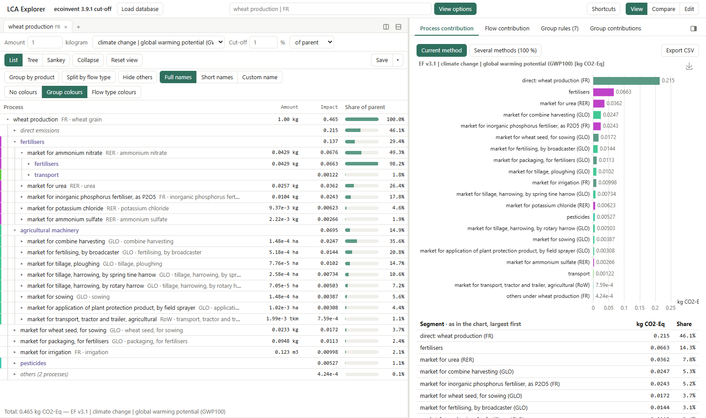</a><br><b>Process tree</b>: expandable list with colour-coded groups, and the contribution chart of what the tree shows.</td>
<td width="50%"><a href="docs/img/gallery/02-sankey.png">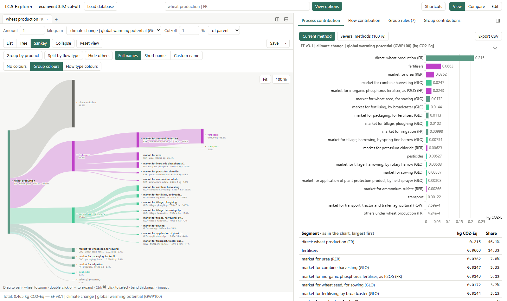</a><br><b>Sankey view</b>: band thickness is proportional to impact.</td>
</tr>
<tr>
<td><a href="docs/img/gallery/03-tree-graph.png">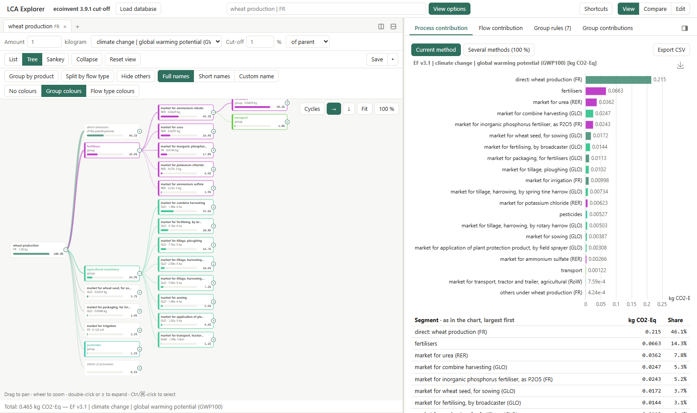</a><br><b>Tree view</b>: the supply chain as nodes and edges.</td>
<td><a href="docs/img/gallery/04-group-rules.png">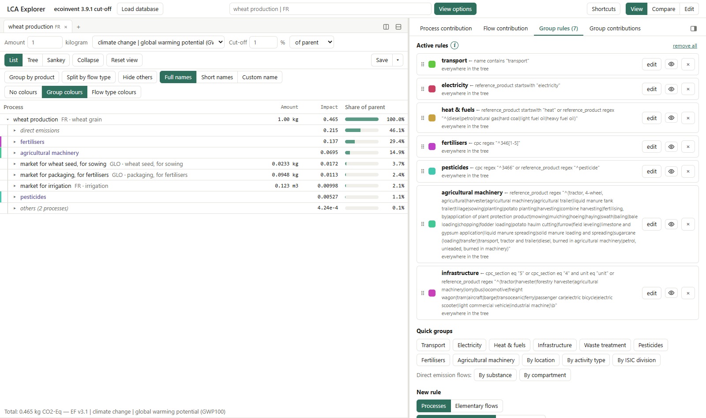</a><br><b>Group rules</b>: quick groups, your own rules from a query or a field, colour coding.</td>
</tr>
<tr>
<td><a href="docs/img/gallery/05-group-contributions.png">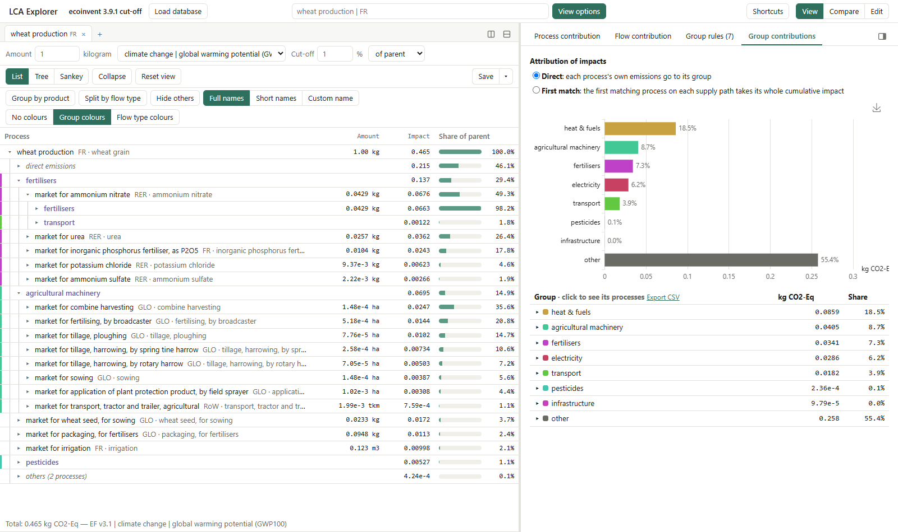</a><br><b>Group contributions</b>: how much electricity, transport, fertilisers... anywhere upstream.</td>
<td><a href="docs/img/gallery/06-flow-contribution.png">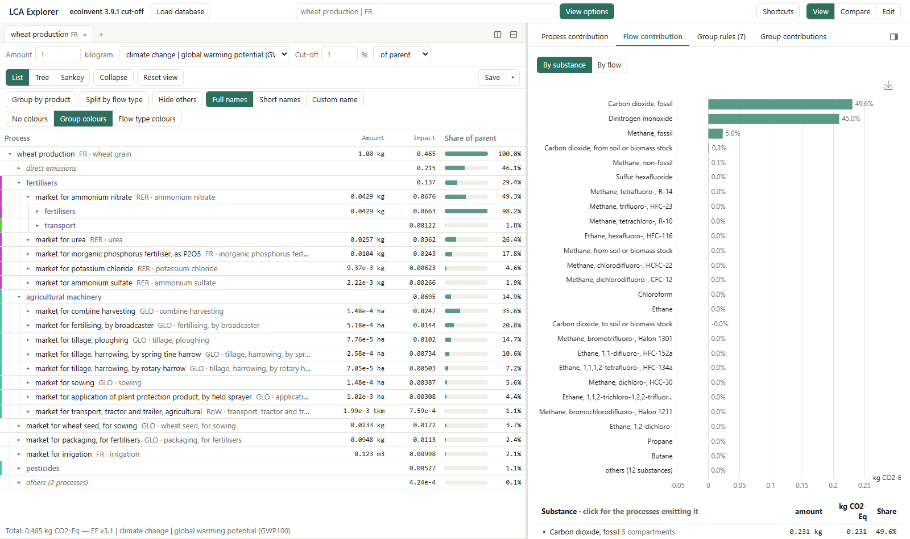</a><br><b>Flow contribution</b>: the score split by elementary flow.</td>
</tr>
<tr>
<td><a href="docs/img/gallery/07-search-filters.png">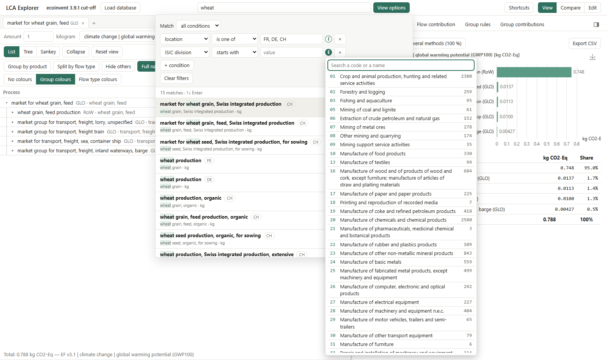</a><br><b>Search with filters</b>: location, CPC and ISIC codes... the (i) lists the values, with names for the codes.</td>
<td><a href="docs/img/gallery/08-alternatives.png">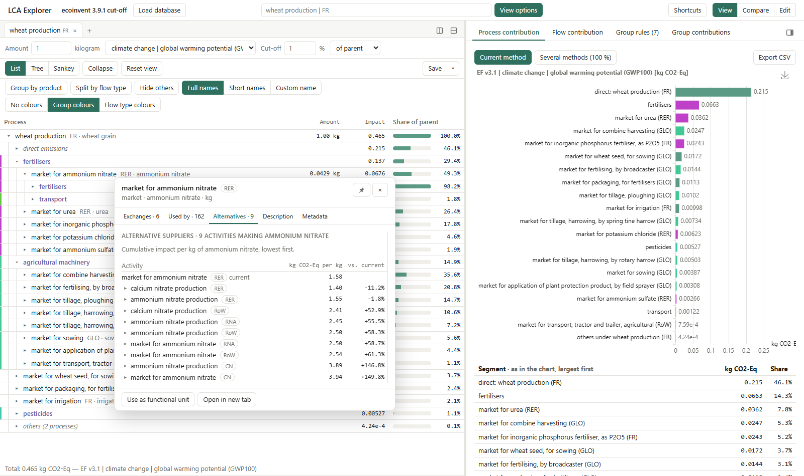</a><br><b>Alternative producers</b>: right-click a process for its exchanges, its users and the other producers of the same product.</td>
</tr>
<tr>
<td><a href="docs/img/gallery/09-split-views.png">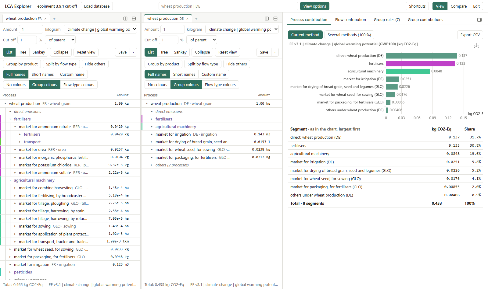</a><br><b>Split screens and tabs</b>: several process views at once; save and load views.</td>
<td><a href="docs/img/gallery/10-compare.png">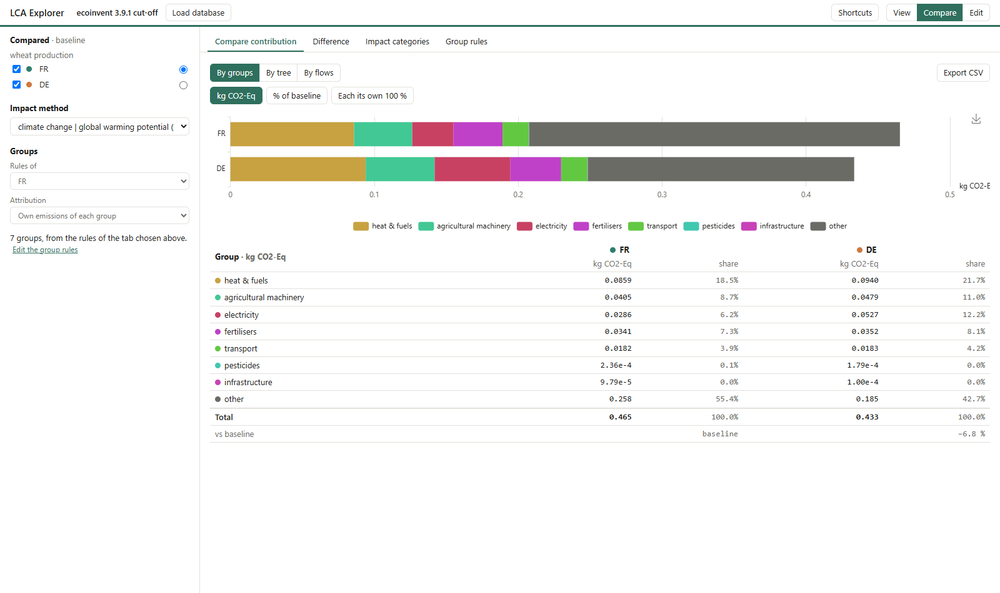</a><br><b>Compare</b>: contributions of several processes side by side, by group, tree or flow.</td>
</tr>
<tr>
<td><a href="docs/img/gallery/11-compare-difference.png">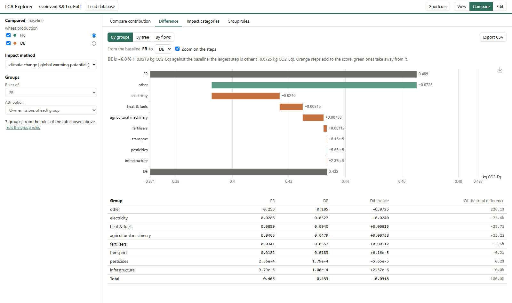</a><br><b>Thematic differences</b>: what makes one process differ from another, step by step.</td>
<td><a href="docs/img/gallery/12-load-database.png">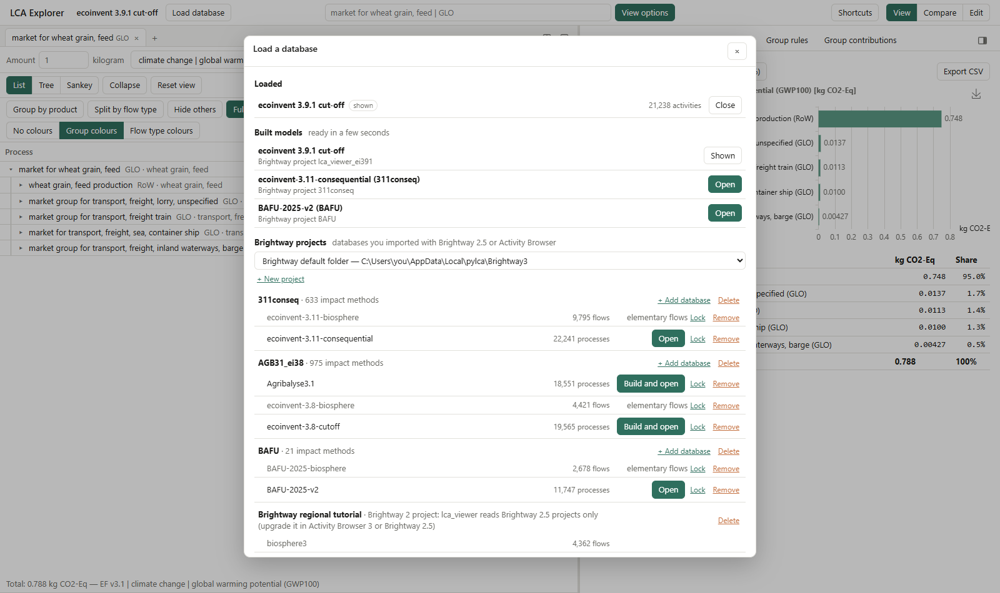</a><br><b>Load database</b>: built models and the databases of your Brightway projects.</td>
</tr>
<tr>
<td><a href="docs/img/gallery/13-add-database.png">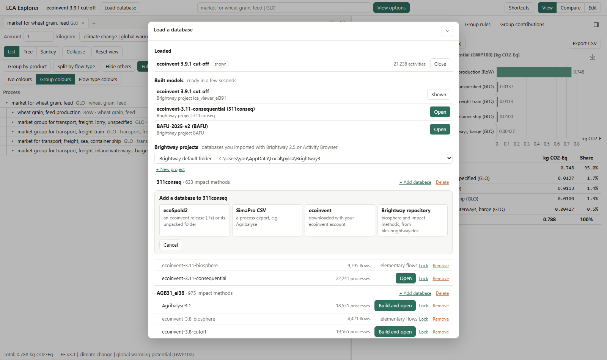</a><br><b>Project manager</b>: new projects, and databases from ecoSpold2, SimaPro CSV, ecoinvent or the Brightway repository.</td>
<td><a href="docs/img/gallery/14-new-process.png">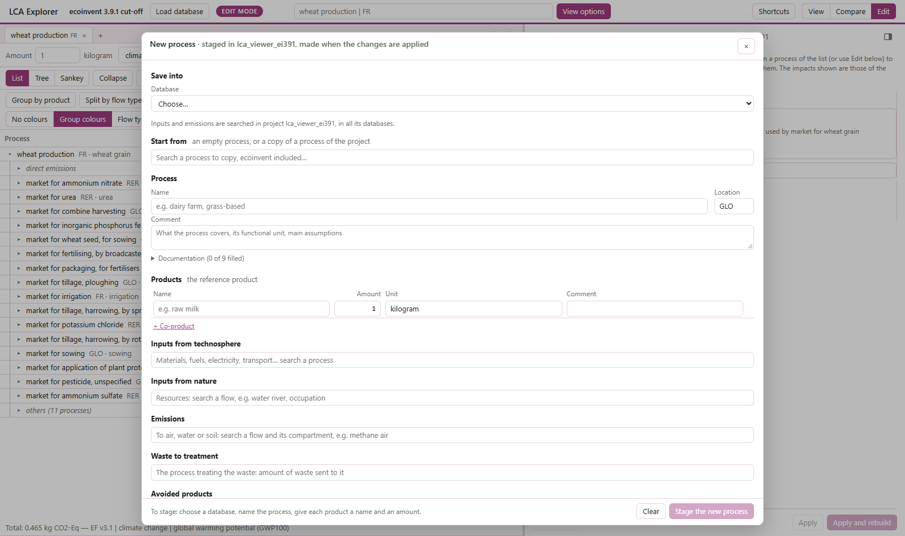</a><br><b>Create and edit processes</b> in your project (<i>Edit</i> mode).</td>
</tr>
</table>

## Quick start

From the repository folder:

```bash
# Windows
lca_explorer.cmd

# macOS, Linux
sh lca_explorer.cmd
```

The first run sets everything up: it finds conda (or offers to install Miniforge in your user folder, no admin
rights), creates a `lca_viewer` conda environment and installs the packages, which takes a few minutes. Every
run then starts the app and opens http://localhost:8765. Extra arguments go to `lca-viewer serve`
(`--port 8800`); `lca_explorer.cmd setup` runs the setup again.

The app starts empty: **Load database** lists the databases of your Brightway 2.5 projects (it reads
`BRIGHTWAY2_DIR`, else Brightway's default folder) and lets you import ecoSpold2, SimaPro CSV or ecoinvent
databases. More in the [user guide](docs/user-guide.md).

## Licence

LCA Explorer is licensed under the [PolyForm Strict License 1.0.0](LICENSE): you may use it for noncommercial
purposes only, and you may not distribute it, change it or make new works based on it. For any other use, ask
the copyright holder. The libraries in `src/lca_viewer/static/vendor/` keep their own licences (MIT, Apache-2.0).

ecoinvent and Agribalyse are licensed: only people covered by an ecoinvent licence may use the explorer on
them, and results must not be shared beyond what that licence allows. The archives and the built models stay in
`data/`, which git ignores: never commit or publish them, or the Brightway projects they come from.
