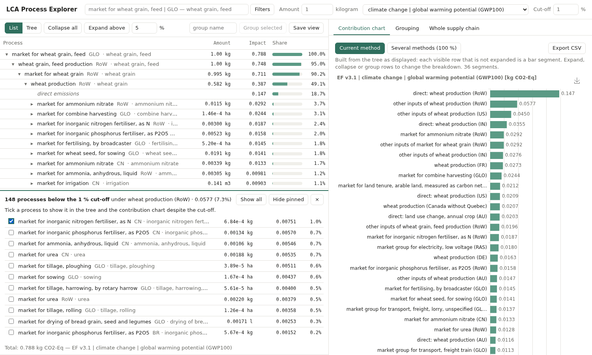
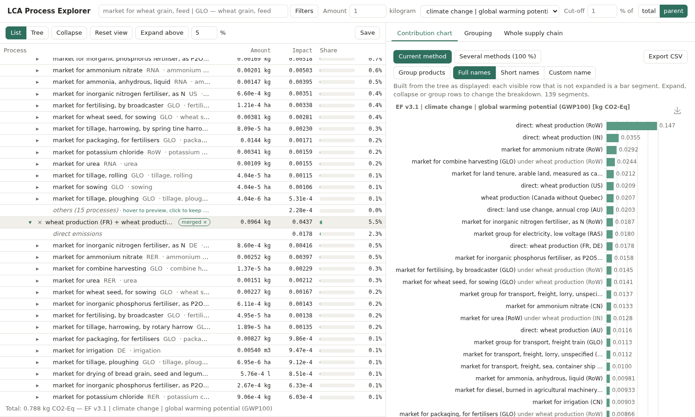

# Grouping

Code: `src/lca_viewer/query.py`, `src/lca_viewer/view.py`, `src/lca_viewer/analysis.py`.
Demo: `scripts/demo_grouping.py` (reference example).

## Decision: two kinds of grouping, kept separate

"Group processes" covers two different questions, and mixing them leads to
double counting:

1. **Tree grouping** — bundle *siblings* under a virtual node
   ("show the European suppliers of this market as one line").
   Purely a display concern: numbers never change.
2. **Global grouping** — "how much does electricity contribute, anywhere in
   the supply chain?". Groups nest (electricity → transport → electricity),
   so an explicit attribution rule is needed.

## Tree grouping (`View` + `GroupRule`)

A rule bundles the children of nodes in its `scope` (one node id, or `*` for
the whole tree). Two forms:

- **named group**: `name` + `predicate` — matching children go into one group;
- **group by**: `by` = a metadata field — children partitioned by value
  (thematic grouping: location, ISIC division, CPC section, activity type…).

Manual grouping = named group with `{"products": [...]}` scoped to one node.
Named groups are applied first, then group-by rules, each in list order (so
a broad "group by location" never swallows a group the user named); a child
goes to the first group claiming it, and groups of one child are not created.
A group that hides an expanded member opens by itself. Group rows can be expanded to show members;
members keep their real node ids, so expansion state survives regrouping.

The view also applies a display **cut-off** (`View.cutoff`, `cutoff_basis`):
under each parent, the smallest children are bundled into one **others** row
as long as their cumulative |impact| stays within x % of the reference:

- `cutoff_basis="parent"`: the parent (sum of the siblings' |impact|);
- `cutoff_basis="total"`: the root score.

Decision: cumulative "bottom x %" rather than "each child below x %", so an
others row never weighs more than x % of its reference — with an individual
threshold, hundreds of small children could add up to a large, opaque
others. The basis is a toggle next to the cut-off ("% of total | parent").

### "Others": cut-off, pins and moved rows

Each parent can have one **others** row (kind `rest`) bundling the siblings
that are not shown individually. A sibling goes there when

- it is below the display cut-off (and not pinned), or
- the user **moved** it there (`View.others`), whatever its impact — to keep
  irrelevant sub-processes out of the tree and the contribution chart.

Conversely, the user can **pin** a row (`View.pinned`) to show it although
it is below the cut-off. Moving wins over pinning. The others row keeps its
`members`, so the UI can show what it contains and why (`moved` / cut-off);
ticking a member shows it again (un-move + pin). Because others is just one
more row on the frontier, totals stay exact whatever is moved or pinned.
A single row below the cut-off is shown as itself, but a single moved row
still gets an others row. Pins and moved rows are part of the saved view and
are cleared when the functional unit changes.

Decision: **changing the cut-off clears pins and moved rows** (with an Undo
notice that also restores the previous cut-off). Pins are exceptions to one
particular cut-off; kept across changes they made a raised cut-off look
ignored ("Show all" pins every member), and moved rows mixed confusingly
with a different set of cut-off rows. **Reset view** does the same plus
collapsing the tree, keeping grouping rules, functional unit, method and
cut-off (also undoable).



### Merge

Merging (`View.merges`: `{"scope": parent id, "products": [...]}`) combines
sibling processes into **one process whose inventory is the union of
theirs**: expanding it shows each input once, with the amounts and impacts of
inputs common to several members summed, and the members' direct emissions
summed. This differs from a group, which only bundles rows (expanding a
group shows the original processes). A merged process's inputs are ordinary
nodes (same product, summed amount), so they expand normally and totals stay
exact by linearity. Its amount is shown only when all members deliver the
same product in the same unit (e.g. wheat grain from FR + DE). Merges are
kept by Reset view and cut-off changes, like groups, and cleared with the
functional unit.



## Queries (`query.py`)

JSON predicates, evaluated vectorised over activity metadata
(21k activities: milliseconds):

```json
{"all": [
  {"field": "reference_product", "op": "startswith", "value": "electricity"},
  {"not": {"field": "location", "op": "in", "value": ["CH", "FR"]}}
]}
```

Operators `eq ne in contains startswith regex`, combinators `all any not`,
explicit `products`. Chosen over a text DSL for the first version because a UI
filter builder maps 1:1 onto it and it is trivially serialisable in saved
views; a text syntax can be parsed into the same structure later.

Derived fields for thematic grouping: `activity_type` (market / market group /
treatment / production, from the ecoinvent naming convention),
`isic_division`, `cpc_section`.

## Global grouping (`analysis.py`)

Both rules are exact and sum to 100 % of the score:

| rule | meaning | computation |
|---|---|---|
| `direct_contribution` | each activity's own emissions go to its group | supply vector × direct impacts |
| `first_match_contribution` | walking down from the functional unit, the first matching activity takes its whole cumulative impact | cut the inputs of matched activities, one extra solve |

The first-match rule is computed with linear algebra rather than traversal, so
it is exact even through loops: with `A_cut` = `A` without the inputs of
matched columns, `s = A_cut⁻¹ f`; a matched product contributes
`s_j · A_jj · G_j`, an unmatched activity its direct emissions `s_j · U_j`.

Reference example (EF 3.1 climate change), same four groups:

| group | direct | first match |
|---|---|---|
| electricity | 12.1 % | 6.6 % |
| fertilisers | 6.6 % | 26.8 % |
| transport | 9.2 % | 10.3 % |
| machinery & diesel | 10.1 % | 17.6 % |
| other (incl. field emissions) | 62.0 % | 38.7 % |

The two readings differ a lot, so charts must always state which rule is used.
