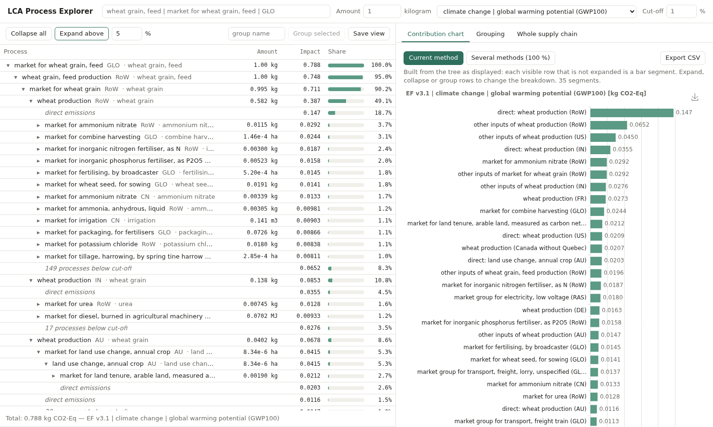
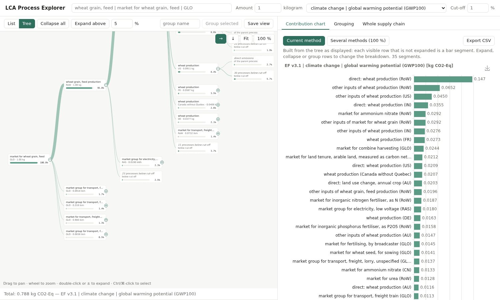
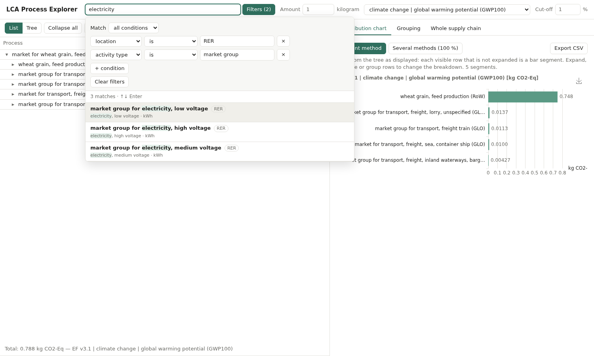
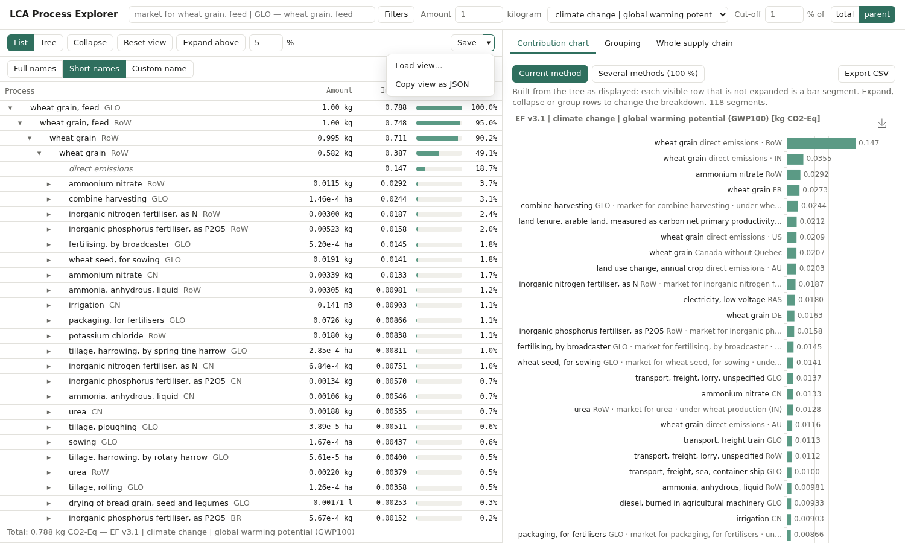

# User interface

Code: `src/lca_viewer/static/` (`index.html`, `app.js`, `style.css`),
API in `src/lca_viewer/server.py`.

## Decision: no-build Preact + htm + ECharts, vendored

- **No build step** (no Node toolchain on the machine, and none needed for a
  local tool): Preact + htm give components with ES modules only.
- **Vendored** in `static/vendor/` (Preact 10.24, htm 3.1, ECharts 5.5): the
  app works offline, which matters for a local-first tool handling licensed
  data.
- **ECharts**: horizontal bars, 100 % stacked bars, PNG export built in, and
  later maps / Sankey for phases 5.
- If the UI grows (virtualised tree for thousands of rows, more panels),
  migrate to Vite + TypeScript; the API does not change.

## Layout

- **Load database** (top bar): the app starts with no database and shows
  this dialog as its start page. Three lists: databases loaded (*Switch to*,
  *Close* to free memory), built models (`data/models.json`, *Open*), and
  the projects of the Brightway data folder (`BRIGHTWAY2_DIR`, else
  Brightway's default folder; *Other folder…* types another), each database with its process count and *Build and open* / *Open*
  / *Rebuild and open*. A load runs on the server: the dialog shows its steps
  (*Details* for the build's output) and opens the database when it is
  ready; it can be closed meanwhile and finds the load again when reopened.
  Decision: one database per page (`/db/<key>/`), switched with the picker
  next to the title, rather than databases mixed in one workspace: tabs,
  saved views and node ids are per model. An address of a database that is
  not loaded (after a restart) shows the start page with a note.
  The Brightway section also changes projects: *+ New project* (empty, or
  from a backup: files.brightway.dev, e.g. BAFU, or a `.tar.gz`), and on
  each project *+ Add database* and *Delete* (typing the name to confirm), and
  on each of its databases *Remove* (after a confirmation; refused while another
  database of the project links to it or its model is open; the model already
  built stays in the app). *Add database* asks for the source (ecoSpold2,
  SimaPro CSV, ecoinvent with the user's account, or *Brightway repository*:
  only the biosphere and impact methods of an ecoinvent version, from
  files.brightway.dev, without a database), with a box *Add the default biosphere and impact
  methods* and their ecoinvent version (detected from the file name or the
  SimaPro background, else chosen), ticked when the project has no biosphere
  database; it opens by itself on a project just created empty. Forms on a
  project, and the jobs started from it, open under its row, where it was
  clicked. Each opens a small form above the
  list (`ProjectForm`); file fields take a path or *Choose file…*
  (uploaded). A SimaPro import that leaves exchanges unlinked shows them,
  with *Import without them…*. Decision: as in Activity Browser, projects
  are created first and databases added to them, so there is one way in for
  each source (ecoinvent no longer makes its own project). These forms sit
  in the Load database dialog, next to the projects they change, rather than
  in a separate manager.
- **Process form** (opened from the edit panel): a wide dialog to enter
  a process as in SimaPro: target (folder, project, database or new one),
  process and documentation, products (co-products with allocation %, their
  sum shown), then one section per exchange kind (technosphere, nature,
  emissions, waste to treatment, avoided products), each with a search box
  over the project (↑↓ Enter to add) and rows with amount, unit, SD² and
  comment. The footer says what is missing before *Stage*. A new process
  is a draft kept in `localStorage` (per browser) until *Clear*. Decision: a dialog over the
  explorer rather than a page of its own, so that one can look up processes
  in the open database while entering a dataset.
  *Start from* (same form) copies any process of the project into it
  (`GET /api/brightway/dataset`, read from the SQLite file).
- **View / Edit switch** (top bar). View is the explorer. Edit swaps the right
  panel for the *edit panel* (the side panel's tabs stay mounted, hidden): the
  focused tab's process with *Edit*, *Copy as new* and *Delete*, *+ New process*,
  the list of staged changes (*Open*, *Remove*), and *Apply and rebuild*. Decision:
  the results shown never change under the user's hands; edits are collected,
  then made in one transaction and the model rebuilt once, instead of a rebuild per
  save. The form (a dialog: its tables need the width) stages instead of writing:
  the change goes to `POST /api/brightway/pending` with the form's state, which is
  how a staged change is opened again. The process of the focused tab is found from the
  activity's database and code. Switching to Edit needs a Brightway-built database.
  *Apply* runs `lca-viewer apply`; with *and rebuild* and when the open database is
  affected, `/api/load` with `reopen`: the old model is served until the new one is ready, then
  the page reloads in View mode.
- **Edit mode and the view.** `EditorContext` carries what the pop-ups and the tree need
  (mode, project, staged changes, locked databases, whether the impacts are stale). In Edit mode
  `FUView` sends `merges: []`, `substitutions: {}`, rules with `merge` off, and applies no custom
  names (they stay in the tab, for View). Conflicts found: a grouping rule's *merge* and the
  alternative supplier *use instead* act on the tree, not the data, so they are off too; pins,
  cut-off and groups stay but act on impacts that may be stale (greyed: `.app.stale .impact`).
  `Editable` is a value that turns into an input on double-click (Enter or blur stages, Escape
  cancels); `quickEdit` patches the form of the dataset (its staged form if there is one) and stages
  it again; exchanges are found by what they link to (`input`, recorded by the build, so models
  built before need one rebuild for amounts to be editable), and an allocated process's share of
  an exchange is scaled back to the dataset's.
- **Rebuild required**: `/api/databases` gives each Brightway-built model's `outdated` (what
  changed in the project since: `sources.changes`); the top bar shows the button when it is set.
- **Locks**: *Lock* in *Load database* (`POST /api/brightway/lock`, kept in `data/locks.json`);
  `/api/brightway` lists `locked` per database and `/api/brightway/dataset` says whether a process is
  locked, which disables its fields, Edit and Delete.
- **Tabs and panes** (like a notes app such as Obsidian): each tab is one
  functional unit with its own tree, method, cut-off, rules and merges. Tabs
  sit on top of their pane: **+** opens an empty tab (the search box takes
  the focus; method, cut-off and tree-wide rules come from the tab it was
  opened from), × or middle-click closes, drag to reorder. Drag a tab onto
  another pane to move it there, or onto a pane's left, right, top or bottom
  quarter to split it (side by side or one above the other); the dividers
  between panes can be dragged. The two buttons at the right of a tab bar
  split right / down with a *copy* of the active tab, e.g. to compare one
  functional unit under two methods. *Open in new tab* in the right-click
  pop-up opens a process as the functional unit of a new tab.
  Decision: one shared **side panel** on the right (process and flow
  contribution, grouping, whole supply chain), showing the active tab of the pane clicked
  last, as in Obsidian's sidebars, rather than one per pane: panes stay wide
  enough for the tree. It is collapsed with » (or *Side panel* in the top
  bar), reopened with «, and resized by dragging its left edge. Each tab
  renders its panels into its own slot of the side panel (a small portal), so
  a tab keeps its panel state (current tab, chart choices) when hidden.
- **Header** (per tab): functional unit search, amount, impact method (all 762
  ecoinvent methods, grouped by family), display cut-off.
- **Search**: free words (each must appear in the name or product, or equal
  the location: `electricity low voltage fr`) and/or **filters** built with
  the same query builder as grouping rules (location, activity type, ISIC,
  CPC, product, …, with value suggestions). Filters alone browse the
  database (e.g. all `RER` market groups). Results show the match count,
  highlighted words, location chips; ↑/↓/Enter to choose, Esc to close.
  Ranking (`query.search`, punctuation ignored): exact name, exact product,
  markets first, name/product starting with the text, text contained as a
  phrase, shorter names.
- **Left — tree**: expand/collapse (▸/▾), amount (waste shown as
  "x kg treated"), impact, share bar — the share **of the total** or **of
  the parent row**, following the cut-off basis switch (total | parent; the
  tree view's boxes too, while edge widths stay shares of the total). A "direct emissions" row
  expands into its elementary flows (substance, compartment, amount
  emitted), groupable by substance or compartment — see
  [grouping.md](grouping.md). Ctrl/⌘-click selects sibling
  rows; a selection bar then offers **Group** (bundle them under one row,
  "ungroup" chip to undo; a group of processes, from any rule or "Group by
  product" (whose "ungroup" chip splits just that group back into its
  members, each of which then has a "regroup" chip that bundles them again;
  turning "Group by product" on again regroups all of them), has a "merge" chip — or select it and click Merge — to turn it into a
  merged process), **Merge** (combine their inventories into one
  process, "merged ×" chip to undo — see [grouping.md](grouping.md)) and
  **To others**. The status bar under the tree sums the selected processes,
  merged processes and groups of processes (a group or merged row counts its
  member processes): amounts per unit (units are not added together) and
  impact; a row inside another selected row is not counted again, its impact
  is in that one's.
  Every row has a **×** (on hover: at the right end of the name in the list,
  after the other row actions; at the box corner in the tree view) that moves
  it to its parent's **others** row; "To others" does the same for a
  selection. Rows shown inside an expanded others row have **pin** instead
  (↑ in the tree view; "Pin" in the selection bar, **o** on the keyboard):
  it takes them out of others, shown despite the cut-off ("pinned ×" to
  undo), like ticking them in the others pop-up. Row actions ("(i)", "✎", "merge", "merged ×", "ungroup",
  "pinned ×", "×") show only on the hovered or selected row.
  **Rename** (✎, or **r** on the selected row): the name is edited in place
  (Enter or leaving the field saves, Esc cancels, **↺** or an empty name
  restores the original; the tree view asks in a dialog). It is a *display* name only,
  part of the tab's view like groups and merges: the database is not changed.
  A process or a flow is renamed wherever it appears (by activity / flow), a
  merged or group row where it is. The custom name replaces the main part of
  the label in the tree, the pop-ups' titles and the chart (direct emissions
  and their flows follow their process's name); the grey qualifier and the
  tooltip (which gives the original name) are kept. Names are saved with the
  view and cleared by Reset view.
  Groups are purple, merged processes blue, direct emissions and others
  grey italic.
  **Every kind of row is explored the same way**: ▸ expands it in place
  (a process into its inputs, direct emissions into flows, a group into its
  members, a merged process into the union of its inputs, others into the
  rows it bundles — which then also replace it in the chart); click selects;
  right-click — or the **(i)** shown on the hovered row, or Space — opens its
  **pop-up**, whatever the kind: the info pop-up below for a process or direct
  emissions, the flow pop-up for an elementary flow, and a **members pop-up**
  for a bundle (others, group, merged; nothing opens on hover or on a plain
  click, which only selects). Members pop-ups follow the view's naming choice;
  clicking or right-clicking a member opens its own pop-up (← comes back).
  - *Others*: what the row contains and why (below cut-off / moved);
    ticking a member **pins** it: shown again in the tree and the chart
    ("pinned ×" chip to undo; *Show all* / *Hide pinned*) — also how to pin
    exceptions to the cut-off. See [grouping.md](grouping.md).
  - *Group* and *merged*: each member's amount and impact (current method),
    absolute and as a share of the row (amount shares only when every member
    delivers the same product), with Merge / Ungroup / Unmerge.
  Decision: bundles first had a panel docked under the tree (opened on
  hover, then on click); it moved into the pop-up so that every row shows its
  details the same way, with the same back navigation.
  **Reset view** goes back to the plain tree: collapsed, no pins or moved
  rows, no groups (every grouping rule, quick groups included, and *Group by
  product*), no merges and no custom names. Changing the cut-off clears pins and moved rows.
  Both show a notice saying what they removed; Ctrl/⌘+Z brings it back.
- **Keyboard** (the tree clicked last; not while typing in a field):

  | Key | Action |
  |---|---|
  | ↓ / ↑ | select the row below / above (from the last position if nothing is selected) |
  | Shift + ↓ / ↑ | extend the selection over siblings (what Group and Merge act on) |
  | → | expand; if already expanded, go to the first child |
  | ← | collapse; if already collapsed, go to the parent |
  | Space | open (or close) the row's pop-up (members pop-up for a bundle) |
  | o | move the selection to others (inside an expanded others row: pin it out) |
  | m | merge the selection, or unmerge a selected merged row |
  | g | one group: ungroup it (a "group by product" becomes an exception, put back by its regroup chip or by g on one of its processes); one process: put back its ungrouped product group, else group its same-named siblings under the product name, else nothing; several rows: group them (named after the product when they all deliver one, else "group N") |
  | r | rename the selected row (display name only) |
  | Ctrl/⌘ + Z | undo the last change to the tree |
  | Esc | clear the selection |
  | Backspace | in a pop-up: back to the previous one |

  After g / m the new group or merged row is selected (the same key undoes
  it); after o, unmerge or ungroup, the row now at the same position is, so
  the keys can be chained. The selected row is kept in view.
- **Left — tree graph** ("Tree" toggle next to "List"): the same visible
  tree drawn as nodes and edges, sharing all state with the list (expansion,
  selection, groups — the chart follows either). Root on the left (→) or on
  top (↓, SimaPro-like). Each box shows name, location, amount and a share
  bar; edge thickness ∝ share of the total, so the main supply paths stand
  out. ± handle or double-click to expand, Ctrl/⌘-click to select, drag to
  pan, wheel to zoom, "Fit" for the whole tree. See below for the layout
  choice.
  **Cycles** (toggle in the graph controls) draws the supply chain as a
  graph rather than a tree: a process used in several places is one node
  with an edge from each place (edges between the same two nodes are
  combined), and a loop — a process reached again inside its own supply
  chain, such as an electricity market through the ENTSO-E market group — is a
  dashed edge back to the node already shown. Direct emissions, flows,
  groups and others hang under their process's node. A node shown in
  several places reads "×N": its amount is the sum of its places, its
  impact counts a place inside another one's supply chain only once (the
  outer place's cumulative impact already includes it), and its share is of
  the total unless it has a single parent. ± expands it at its first place
  and collapses it everywhere; click, right-click and the row actions act on
  its first place.
- **Left — Sankey** ("Sankey" next to "List" and "Tree"): the same visible
  tree as a flowchart. Each row is a bar as tall as its |impact| (the root
  480 px at 100 %), joined to its parent by a band of the same thickness, so
  the bands leaving a process add up to its bar and the main supply paths
  are the widest. Bars and bands are coloured like the list (groups purple,
  merged processes blue, direct emissions and others grey); the label beside
  each bar gives the name, qualifier, amount and share (of the total or of
  the parent, as in the other views). ▸ or double-click expands, click and
  Ctrl/⌘-click select, right-click opens the pop-up, drag pans, wheel zooms;
  row actions are in the selection bar and the pop-ups. Always a tree drawn
  left to right: the Cycles and orientation controls are hidden here.
- **View bar** (under the toolbar): *Group by product* and *Full / Short /
  Custom* names, applied
  to the list, the tree view, the others panel and the chart; see
  [charts.md](charts.md).

  
- **Right-click a process** (list or tree view): pop-up with its place in
  this tree (amount, impact, path from the root), per-unit cumulative and
  direct impacts, the main direct emissions for the current method,
  **Used by** (the activities consuming its product — or, for a waste
  treatment, generating the waste — with the amount per unit of their
  product and, largest first, the amount each takes in this functional
  unit's supply chain and its share; click one for its own pop-up, *go to*
  to open the tree at it), the ecoinvent description, included activities, time period, classifications,
  authors and file; actions "Use as functional unit" and "Move to others".
  Descriptions are stored in the cached model (`details.pkl`, 77 MB for
  ecoinvent, loaded on first use).
  **Exchanges** as recorded in the dataset, by direction: *Products* (the
  reference product, and co-products if any), *Inputs from technosphere*,
  *Inputs from nature* (natural resources), *Outputs to treatment* (waste:
  technosphere exchanges with a negative amount, shown as positive) and
  *Emissions*, each with amount, impact per unit of product and share of the
  cumulative impact, largest first. The **(i)** shown on the hovered item
  opens its own pop-up (the supplying activity, or the elementary flow with
  this process's exchange); click a row (▸) for its comment, uncertainty
  (distribution, σ with and without pedigree), pedigree scores, formula and
  variable name. For a tree row, *In this tree* also shows the parent's
  input of this product with its comment and uncertainty. *Reference product
  exchange* gives the production volume and product properties (price,
  carbon and water content, dry mass, …). Exchanges are stored in the cached
  model (`exchanges.sqlite`, 105 MB for ecoinvent 3.9.1, read one activity
  at a time); a model built before this has none — rebuild it to see them.
  The pop-up is split into tabs — *Exchange* (the parent's input of this
  product: amount, comment, uncertainty, pedigree; "In this tree" for the root
  or a direct emissions row), *Results*, *Exchanges*, *Used by*,
  *Description* (with the reference product exchange) and *Metadata* — so the
  target is one click away. A right-click on a tree row opens *Exchange*, on a
  direct emissions row *Exchanges* (emissions first); following a link inside the pop-up keeps the
  current tab. Empty tabs are not shown. Links followed inside a pop-up (a
  supplier, a user, an exchange's (i), a flow's emitter) are kept in a
  history: **←** next to × (or **Backspace**) goes back; opening a pop-up
  from outside, or closing it, starts a new history.
- **Right-click an elementary flow** (a flow row in the tree, in an others or
  group panel, or a substance / flow of the *Flow contribution* tab): pop-up
  with tabs *Exchange* (for each process emitting it there — the emitting
  process, or every member of a merged one — the exchange as recorded in its
  dataset: amount, comment, uncertainty, pedigree, formula), *Characterisation*
  (its factor in every method of the model that has one, the current method
  highlighted, filterable) and *Metadata* (name, compartment, unit, database
  id). For a substance spread over several compartments, chips switch between
  them. API: `/api/flow/{index}?method=&activities=`.
- **Side panel — tabs**:
  - *Process contribution* (the former contribution chart): current method
    bars, or several methods as 100 % stacked bars; CSV export. See
    [charts.md](charts.md).
  - *Flow contribution*: the score split by elementary flow: the whole
    inventory of the functional unit (B·s) times the current method's
    characterisation factors, so it sums to the total. *By substance*
    sums the compartments of a substance (one row per name and unit), *By
    flow* keeps them apart. Bar chart of the 25 largest |impacts| (the rest
    as *others*) and a table with amount, impact and share; click a
    substance or flow (bar or row) to list the processes emitting it in the
    supply chain, with their own amount and impact. As in *Whole supply
    chain*, right-click (or double-click) one to go to it in the tree or
    open its details, or *Exchange…* for its exchange of that flow.
    Right-click a substance or flow for its pop-up (below). API:
    `/api/flows`, `/api/flows/contributors` (`analysis.flow_contribution`,
    `flow_contributors`).
  - *Grouping*: active rules (reorder / remove; **merge** turns every group
    of a process rule into a merged process, **disable** / **enable**
    switches a rule off and on without losing it), quick groups (transport,
    electricity, heat & fuels, infrastructure, waste treatment, pesticides
    (CPC 3466 and "pesticide, unspecified"), fertilisers (CPC 3461–3465:
    mineral, organic and organo-mineral fertilisers, manure), agricultural
    machinery (tractors, harvesters, agricultural machinery and trailers, and
    the field operations using them: tillage, sowing, harvesting, spraying,
    fertilising, mowing, … — by product name, as ecoinvent names them), by
    location / activity type / ISIC), and the shared query builder — the same component as the search
    filters, so a filter reads and behaves the same in both places — with a
    live "matches N activities, e.g. …" preview; scope everywhere or under
    the selected row.
  - *Whole supply chain*: global grouping with the named groups, direct
    (the default) or first-match attribution (see [grouping.md](grouping.md)),
    groups sorted by decreasing impact with *other* last.
    Named rules on elementary flows are **flow groups** ("flows" chip): process
    groups come first and keep every flow they reach first; flow groups split
    the rest (emissions of processes outside the groups);
    add one with *Add as a group* on a substance (or a flow) in the *Flow
    contribution* tab. Clicking a group
    lists the processes it is made of; right-click one for *Go to in tree*
    (opens and highlights it along its largest supply path) or *Details*.

## Tree graph layout

Decision: own tidy-tree layout and SVG rendering instead of a graph library
(ECharts `tree` series, d3-hierarchy, …). The layout is ~20 lines (leaves
take consecutive slots, a parent is centred on its children, depth sets the
other axis), and owning the SVG gives full control over boxes with impact
bars, per-edge widths, selection and grouping interactions — which the
ECharts tree series does not offer. Opening a functional unit zooms to a
readable 60 % centred on the root rather than fitting a large tree into an
unreadable thumbnail; "Fit" shows everything. The view does not re-fit on
each expansion, so the user keeps their place.

In cycles mode the same tidy layout is applied to a breadth-first spanning
tree of the graph (each node at its shortest distance from the root, under
the first node reaching it); the other edges are drawn on top, those going
to a node at the same depth or nearer the root (loops) curving round from
the far side of the source box to the near side of the target. Decision:
no force-directed or layered (Sugiyama) layout, so that switching the mode
keeps the familiar left-to-right reading of the tree.

The Sankey has its own layout in the same SVG shell (pan, zoom, Fit), not
the ECharts sankey series: ECharts lays out nodes itself, which would move
every bar on each expansion, and has no expand, selection or pop-up
interactions. A column per depth; a subtree takes the height of its bar, of
its children stacked, or of two label lines, whichever is largest, with the
bar centred on it; bands leave the parent stacked in row order. A row too
small to see keeps a 1.5 px bar.

Display choice (list / tree / Sankey), orientation and cycles mode are per-browser
preferences (`localStorage`).

## State

The client owns the view state (`root`, `amount`, `method`, `cutoff`,
`expanded`, `rules`, pins, moved rows, merges) and posts it to `/api/rows` on
every change (~70 ms on ecoinvent). Each tab's state, the pane layout and
the focused pane are kept in `localStorage` per browser (convenience only),
so tabs and splits come back on reload; a view saved before tabs existed
opens as the first tab. A tab moved to another pane is rebuilt from its
saved state (selection and undo are not kept).

**Save ▾** downloads the view as JSON; the arrow menu offers *Load view…*
and *Copy view as JSON*. Files are `version` 2: `cutoff` is a fraction, as in
`/api/rows` (0.05 for the 5 % shown in the page); version 1 files stored the
percentage and still load. The `labels` of a file (`p:<activity>`, `f:<flow>`,
`r:<row id>`) can be sent to `/api/rows` too: the rows they name come back with
the name as `custom`. `GET /api/lookup?name=&location=` says whether an
activity exists, and lists the same name in other places or the closest names
(`matches`, `same_name`, `similar`). Saved files record the model (title, size), the
functional unit's name and location, method names and the naming settings,
besides positions. Node ids are positions in the model, so on load, if the
functional unit is not at the same position (view saved from another model
or database version), it is found by name and location and only the
position-free parts are applied (functional unit, amount, method, cut-off,
rules scoped everywhere, names); expansions, pins, moved rows and merges are
dropped, and the notice says so. Loading can be undone with Ctrl/⌘+Z.

**Undo** (Ctrl/⌘+Z): each change of the tree — groups,
ungroups, merges, pins, moved rows, names, cut-off, amount, method, display
settings and a functional unit change — is a step, and undo goes back one step
at a time. Expanding and collapsing are not steps of their own: they are kept
with the step they fall in. A tab's first functional unit has nothing to go
back to. Steps are kept per tab and not saved.

Expansion semantics: a group that hides an expanded member opens by itself,
so adding a group-by rule does not hide the branch being explored; collapsing
it on purpose is remembered as `!<group id>` in `expanded`.

## Verification

Screenshots are taken headless with Playwright (`chromium-headless-shell`).
The container lacks `libnss3`/`libnspr4`; they are installed from
conda-forge in `~/.cache/lca_viewer_browser_libs` and passed with
`LD_LIBRARY_PATH` (no root needed).
