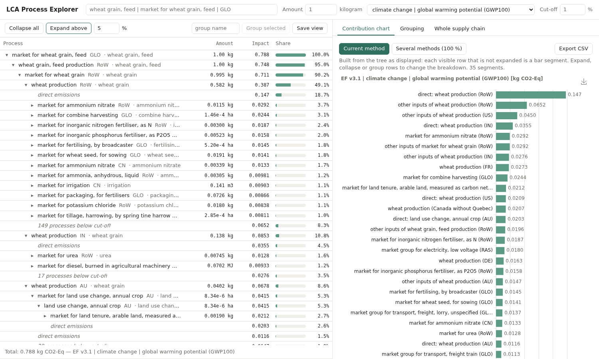
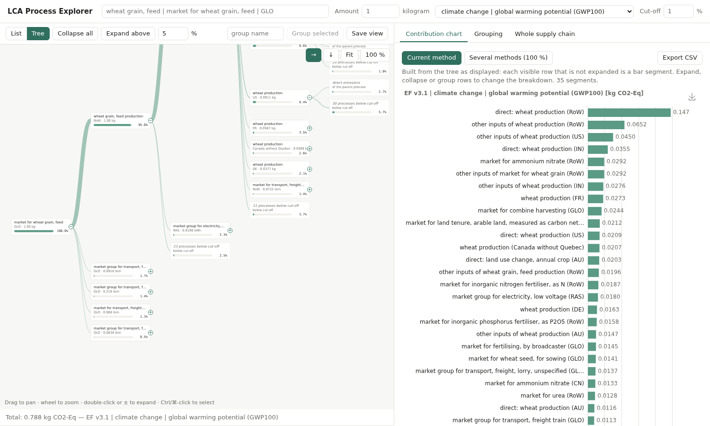
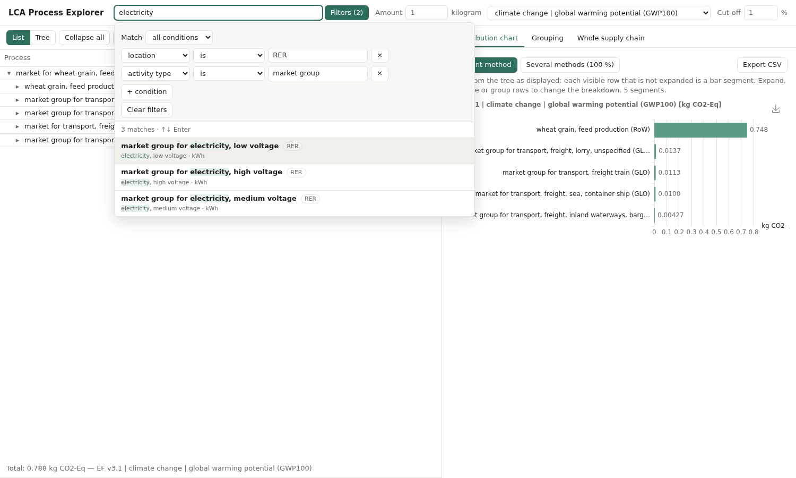
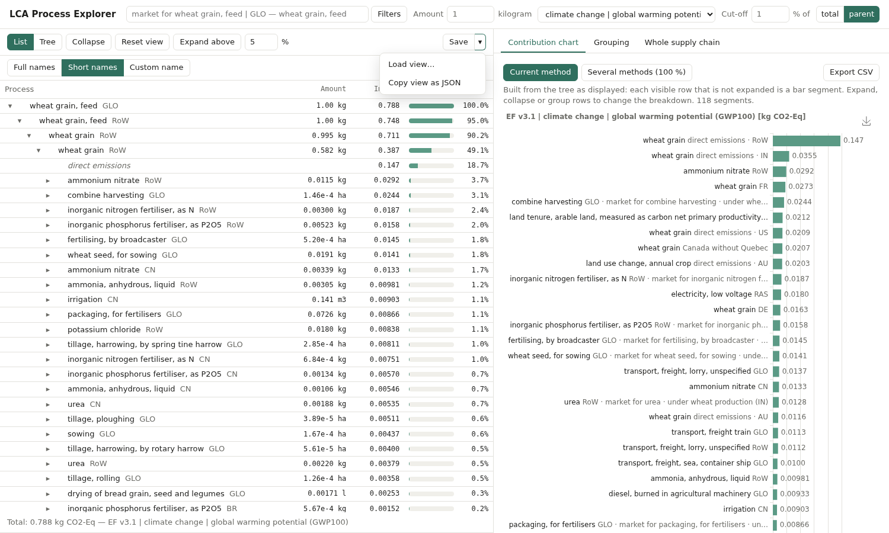

# User interface

Code: `src/lca_viewer/static/` (`index.html`, `app.js`, `style.css`),
API in `src/lca_viewer/server.py`.

## Decision: no-build Preact + htm + ECharts, vendored

- **No build step** (no Node toolchain on the machine, and none needed for a
  local tool): Preact + htm give components with ES modules only.
- **Vendored** in `static/vendor/` (Preact 10.24, htm 3.1, ECharts 5.5): the
  app works offline, which matters for a local-first tool handling licensed
  data.
- **ECharts**: horizontal bars, 100 % stacked bars, PNG export from each panel's export icon, and
  later maps / Sankey for phases 5.
- If the UI grows (virtualised tree for thousands of rows, more panels),
  migrate to Vite + TypeScript; the API does not change.

## Layout

- **Projects** (top bar; it was *Load database*): the app starts with no database and shows
  this dialog as its start page. One list: the projects of the Brightway data folder (`BRIGHTWAY2_DIR`, else
  Brightway's default folder; *Other folder…* types another), each with its databases and their process count.
  Decision: a Brightway **project** holds databases, the elementary flows and the impact methods, and is what one
  imports into and manages; a **database** is one dataset of a project (ecoinvent, BAFU…), the unit the app
  opens. The dialog used to list loaded databases, built models and projects apart, each with its own buttons;
  a database now has one state and two buttons. **Open** (*Shown* for the one on screen; *Build and open* the
  first time and *Rebuild and open* when the project changed since the build, about a minute for
  ecoinvent, kept in `data/cache`), and **Options ▾**: *Close (free its memory)* for one that is open,
  *Open the old build* when a rebuild is due, *Rebuild and open* when none is (for what a newer version of the
  app records, as the method factors on flows outside the model), *Lock* / *Unlock*, *Rename…*, *Add database…* and *Remove…*. A project
  has *Options ▾* too: *Add database…* and *Delete project…*. The projects are listed with the last one opened first
  (a project with an open database on top) and their databases folded, a click on a project's arrow
  shows them; both are remembered. Models that no listed database explains (built from
  files, or from a database renamed since) are under *Other models*. A load runs on the server: the dialog shows
  its steps (*Details* for the build's output) and opens the database when it is
  ready; it can be closed meanwhile and finds the load again when reopened.
  Decision: one database per page (`/db/<key>/`), switched with the picker
  next to the title, rather than databases mixed in one workspace: tabs,
  saved views and node ids are per model. An address of a database that is
  not loaded (after a restart) shows the start page with a note.
  Next to *+ New project* (and *Refresh*), an icon (a database cylinder) opens **Storage**: what the project
  caches and Brightway projects take on disk, and what can be deleted. Decision: it was a button of the top bar;
  disk use is a matter of projects, so it sits with them, and the top bar keeps the search and the mode switch.
  The dialog also changes projects: *+ New project* (empty, or
  from a backup: files.brightway.dev, e.g. BAFU, or a `.tar.gz`), *Delete project…* (typing the name to
  confirm), and on a database *Remove…* (after a confirmation; refused while another
  database of the project links to it or its model is open; the model already
  built stays in the app) and *Rename…* (refused while another database links to it, it is locked or open: the
  links inside the database follow its name; `lca-viewer database rename`). *Add database* asks for the source
  (ecoSpold2, SimaPro CSV, BAFU from files.brightway.dev, ecoinvent with the user's account, *Brightway repository*:
  only the biosphere and impact methods of an ecoinvent version, from
  files.brightway.dev, without a database, or *Another project*: a copy of a database of another project, or of
  this one, under a new name, linked to the same biosphere and background databases, which the project must have
  by the same names; `lca-viewer database copy --from-project`), with a box *Add the default biosphere and impact
  methods* and their ecoinvent version (detected from the file name or the
  SimaPro background, else chosen), ticked when the project has no biosphere
  database; it opens by itself on a project just created empty. Forms on a
  project, and the jobs started from it, open under its row, where it was
  clicked. Each opens a small form above the
  list (`ProjectForm`); file fields take a path or *Choose file…*
  (uploaded). A SimaPro import that leaves exchanges unlinked shows them,
  with *Import without them…*. Decision: as in Activity Browser, projects
  are created first and databases added to them, so there is one way in for
  each source (ecoinvent no longer makes its own project). These forms sit
  in the Projects dialog, next to the projects they change, rather than
  in a separate manager.
- **Methods library** (a section of *Projects*, below the projects, folded and unfolded with its arrow; see
  `docs/methods-library.md`): impact methods of the user's own, kept by the app in `data/methods/` (one JSON file
  each), not by a project. Its **+** adds one: *Copy a method of a project…* (an editable copy, its family marked
  *(copy)*), *New empty method…* (name parts and unit) or *Import a CSV file…* (flow name, compartment,
  subcompartment, unit, factor, matched to the elementary flows of a project chosen in the form; the rows of no flow
  are listed with the reason). The methods are listed by family, with their unit, origin and number of factors; *Edit*
  opens the **method editor** under the row (`MethodEditor`, in the style of `ProjectForm`): name parts, unit and
  description (*Save*), the factors with a filter, a value saved when its field is left, × to remove one, and a
  factor added by searching the emissions or resources of a project (`NodePicker`) with the value typed beside it;
  the factors whose flow the project chosen does not have are greyed out. Then *Import CSV…*, *Export CSV*,
  *Duplicate…* and *Delete…* (confirmed), also in the row's ⚙ menu. Building a database offers the library's methods
  after the project's, as the source *library* ("EF v3.1 (copy) · library"), and so does *Add impact methods* of the
  Methods panel. Decision: the app's own files rather than methods written into each Brightway project (through a
  subprocess, and marking all the project's databases as to rebuild at every write): a library method is not tied to
  one project, and is matched to the flows of each build's project (by key, by code, else by name and compartments).
  Decision: a section of the Projects dialog, with its forms inline, as the project forms are, rather than a dialog of
  its own: one place for what a build is made of. Decision: a factor changed is written at once; a database built
  with a method edited since is shown as to rebuild (*methods of the library changed since the model was built*).
- **Process form** (opened from the edit panel): a wide dialog to enter
  a process as in SimaPro: target (folder, project, database or new one),
  process and documentation, products (co-products with allocation %, their
  sum shown), then one section per exchange kind (technosphere, nature,
  emissions, waste to treatment, avoided products), each with a search box
  over the project (↑↓ Enter to add) and rows with amount, unit, SD² and
  comment. The footer says what is missing before *Stage*. A new process
  is a draft kept in `localStorage` (per browser) until *Clear*. Decision: a dialog over the
  explorer rather than a page of its own, so that one can look up processes
  in the open database while entering a dataset.
  *Start from* (same form) copies any process of the project into it
  (`GET /api/brightway/dataset`, read from the SQLite file).
- **Mode switch** (top bar, at the right: **View / Compare / Edit**; keys v, c, e). Decision (tried and dropped): Edit
  mode entered from a process card (an *Edit* button on its *Exchanges* panel, amounts edited there in place) instead
  of the top bar; the mode is the whole app's, so its switch stays with the other modes, in the top bar.
- **Compare mode** (the middle button): the workspace and the side
  panel give way to a comparison of the processes of the open tabs (the
  tabs stay mounted, so nothing is lost when going back). The tabs to
  compare are ticked in the **Processes** tab of the left panel, the first one (the radio
  marks the **baseline**, the others are read against it; all tabs by default); the impact
  methods and the group rules are those of the workspace (see **Methods and Rules**
  below). Decision: a *Compared* column of its own in this mode was a third place for
  settings that the panel already holds, so the panel lists the tabs, and a strip over the
  panels keeps the attribution and the notes. Tabs are named by what tells them apart (the place when
  they share the process). Three panels, each with CSV export. The first two split the
  bars the same way, chosen with the switch **By groups / By tree / By flows** (shared
  by both):
  - *By groups*: the named rules of the workspace's rule set (process rules as groups,
    flow rules as flow groups, as in the side panel's *Rules*), and the attribution (*own
    emissions of each group*, or *whole supply chain below the first match*, see
    [grouping.md](grouping.md)). The rules are edited in the *Rules* panel on the left (link under
    the groups): the same rule set as in the tabs that follow it, so a change there is seen in
    them and the other way round, without leaving Compare mode; a tab with rules of its own is not read (the
    page says so). A tab counts by
    its process and amount; its cut-off, expansion, merges and substitutions do
    not enter (`POST /api/compare` works on the matrices, each entry split exactly into
    the groups and *other*; the page warns when a tab has substitutions, or when the
    units differ).
  - *By tree*: the tree each tab displays in View mode (`/api/rows` from the tab's
    own view: expansion, groups, merges, restored rows, substitutions, cut-off, at the
    comparison's method): its expanded rows are split, the others are bars. Bars are
    lined up by process (wherever it is in the tree; its direct emissions, flows and
    others row go with it); the process of each tab is the same bar whatever
    process it is. A process expanded in one tab and collapsed in another shows as its
    inputs on one side and as one bar on the other, so shape the trees alike.
  - *By flows*: the elementary flows of the whole inventory (`basis: "flows"`), one per
    substance, the largest *n* over all tabs (5 to 40) and *other* for the rest.
  A row a tab does not have shows as – in the table.
  - *Compare contributions*: one stacked bar per tab, in the unit, as % of the
    baseline's total, or each as its own 100 %; the table under it has a value and a
    share column per tab (numbers right-aligned, the totals in the same columns) and
    the change against the baseline.
  - *Cascade*: a waterfall from the baseline's total to another tab's, one step per
    group, row or flow (largest first; orange adds, green takes away; the steps add up to the
    difference exactly). The axis starts near the steps when the difference is
    under 25 % of the totals (the totals are then cut). With more than two tabs, a menu
    chooses the tab read against the baseline.
  - *Multi indicator matrix*: a heat map of tabs × the methods ticked in the *Methods* panel
    (the methods shown together; the family of the first method to begin with); the
    active method is the one of *Compare contributions* and *Cascade*. Each cell is the change against the baseline
    (the colour stops at ±100 %; values in the tooltip), optionally with the largest
    difference first.
  Decision: a mode of its own, not a panel of the side panel: the side panel shows
  one tab, and a comparison needs several. Tabs, not a new kind of object, so that
  a comparison is made of what is already open. Groups instead of tree rows so that
  tabs with different supply chains line up (`charts.md` has the same reasoning).
  The choices are kept while the page is open, not saved.
- **View / Edit switch** (top bar). View is the explorer. Edit swaps the right
  panel for the *edit panel* (the side panel's tabs stay mounted, hidden): the
  focused tab's process with *Edit*, *Copy as new* and *Delete*, *+ New process*,
  the list of staged changes (*Open*, *Remove*), and *Apply and rebuild*. Decision:
  the results shown never change under the user's hands; edits are collected,
  then made in one transaction and the model rebuilt once, instead of a rebuild per
  save. The form (a dialog: its tables need the width) stages instead of writing:
  the change goes to `POST /api/brightway/pending` with the form's state, which is
  how a staged change is opened again. The process of the focused tab is found from the
  activity's database and code. Switching to Edit needs a Brightway-built database.
  *Apply* runs `lca-viewer apply`; with *and rebuild* and when the open database is
  affected, `/api/load` with `reopen`: the old model is served until the new one is ready, then
  the page reloads in View mode.
- **Edit mode and the view.** `EditorContext` carries what the pop-ups and the tree need
  (mode, project, staged changes, locked databases, whether the impacts are stale). In Edit mode
  `FUView` sends `merges: []`, `substitutions: {}`, and applies no custom
  names (they stay in the tab, for View). Pins, cut-off and groups stay but act on impacts that may
  be stale (greyed: `.app.stale .impact`). Edit mode is plum (`.app.editing` redefines the accent,
  bar and background variables, an EDIT MODE badge and an underlined top bar), View mode green. In
  View mode with changes staged, the Edit button reads *Edit (n staged)* and a warning under the top
  bar offers to review them (`.staged-warning`).
  `Editable` is a value that turns into an input on double-click (Enter or blur stages, Escape
  cancels); its `start` prop (a new object each time) opens it without a double-click; its `format` prop
  (`fmtAmount` for amounts) is how the value reads when not edited, the input has it in full;
  `quickEdit` patches the form of the dataset (its staged form if there is one) and stages
  it again; exchanges are found by what they link to (`input`, recorded by the build, so models
  built before need one rebuild for amounts to be editable), and an allocated process's share of
  an exchange is scaled back to the dataset's. The list has no direct editing: **e** on the selected
  process opens its form (`DatasetForm`), where everything is changed; the pop-ups' values are still
  edited by double-click. An exchange's source is replaced in the process form
  (*replace* on its row: the exchange keeps its id, amount, comment and uncertainty; `editing._update_exchange`
  links it to the new process or flow) and, for a product, with *use instead* in the *Alternatives*
  panel of its pop-up, which stages that replacement in the dataset(s) of the process(es) above it.
- **Rebuild required**: `/api/databases` gives each Brightway-built model's `outdated` (what
  changed in the project since: `sources.changes`); the top bar shows the button when it is set.
- **Locks**: *Lock* in *Projects* (`POST /api/brightway/lock`, kept in `data/locks.json`);
  `/api/brightway` lists `locked` per database and `/api/brightway/dataset` says whether a process is
  locked, which disables its fields, Edit and Delete.
- **Tabs and panes** (like a notes app such as Obsidian): each tab is one
  process with its own tree, method, cut-off, rules and merges. Tabs
  sit on top of their pane: **+** opens an empty tab (the search box takes
  the focus; method, cut-off and tree-wide rules come from the tab it was
  opened from), × or middle-click closes, drag to reorder. Drag a tab onto
  another pane to move it there, or onto a pane's left, right, top or bottom
  quarter to split it (side by side or one above the other); the dividers
  between panes can be dragged. The two buttons at the right of a tab bar
  split right / down with a *copy* of the active tab, e.g. to compare one
  process under two methods. *Open in new tab* in the right-click
  pop-up opens a process as the process of a new tab. A tab is a pop-up kept in the grid: the first
  line of a tab shows the **panels of the pop-up** (*Explore*, the tree; *Exchanges*; *Characterisation*; *Used by*; *Alternatives*;
  *Description*; *Metadata*), and dragging a pop-up by its header onto the grid makes it a tab.
  Decision: one shared **side panel** on the right (process and flow
  contribution, group rules, group contributions), showing the active tab of the pane clicked
  last, as in Obsidian's sidebars, rather than one per pane: panes stay wide
  enough for the tree. It is hidden with the side-panel icon at the end of its tab bar
  (a window with a filled panel on the right, as in VS Code and Obsidian; the edit panel
  has it in its title), shown again with the same icon, empty, on the right edge of the
  page, and resized by dragging its left edge. Each tab
  renders its panels into its own slot of the side panel (a small portal), so
  a tab keeps its panel state (current tab, chart choices) when hidden.
  The two side panels are **fitted to the window** (`leftWidthFor`, `sideWidthFor`): the workspace between them
  keeps `WORKSPACE_MIN` (360 px), the left panel is fitted first (leaving the side panel its minimum), and the side
  panel takes at most what is left, when dragged, when the other one opens and when the window is resized; dragging
  one does not shrink the other. A width dragged is kept and shown fitted. A window too small for both minimums
  squeezes the workspace, and `.body` clips (`overflow-x: clip`) rather than make the page wider than the window.
  Decision: a first version clamped each panel to the window alone, so the side panel dragged wide with the left
  panel open pushed the page past the window's right edge.
  Only process tabs fill the side panel and the left panel's *Rules* (slots `side-<id>`, `groups-<id>`): while a
  **flow or model tab** is in focus they show those of the **process tab last in focus** (`App` keeps them, last
  first, in `processFocus`; else the first process tab open), under a muted line *Showing ‹process›, the last process
  in focus* (`PanelsFollow`); with no process tab open, a note that they follow a process tab. Decision: rather than
  blank panels (a first version left them empty), or panels of their own for flow tabs, which have their pop-up's.
- **Top bar**: in the middle, the **search** of a process, like a command palette
  (Ctrl/⌘ + K focuses it; Enter makes the result the process of the tab in
  focus, Ctrl/⌘ + Enter opens it in a new tab); the mode switch is at the right. At the left, the title, the
  database and *Projects* (Storage is in the Projects dialog). No *Shut down* button: the app started on your own
  computer stops when its last tab closes (`lifetime.py`; the browser asks first), which is how it is shut down.
  Decision: one way to stop it, the one every browser user knows; a button did the same as closing the tab.
- **Status bar** (bottom of the page): at the left the **focused card**, the object of the active tab of the
  window in focus (*Process · name (location)*, *Flow · name (compartment)*, *Model · method*; read from the
  tab's title, `focusedCardLabel`; a long name ends in an ellipsis), whose click opens its pop-up
  (`POPUP_OPENERS`; in Compare mode View mode first, the tab being hidden), then the active method and the rule
  set; at the right the **Settings** icon (the colours of every *Color by* mode), the **Shortcuts** icon and the
  **Source** icon (`</>`, the source code: `SOURCE_URL`, as the AGPL asks; it was a link of the top bar).
  The **view options** belong to each process tab: the sliders icon of its row in the
  left panel's *Processes* panel opens them in a pop-up (the tab is shown in its window first, as a click on its name),
  and key v in View mode opens those of **the tab in focus**, the one of the window (split pane) used last. One line
  each and in this order: *Display* (List / Tree / Sankey), *Cut-off*, *Names*, *Organise by*, *Group by*, *Color by*,
  then *Rows*; *Reset* and *Save* are icons at the top right of the pop-up (Save's arrow: Load, Copy, Default
  settings). The pop-up is drawn by the tab itself, on the page, so it stays open (pinned) while the tab is hidden;
  flow tabs have no view options. Decision: the options were the top of the side panel's first panel, which showed
  those of the tab in focus only; on each process of the *Processes* panel, which tab they change is plain, and the
  side panel keeps its room for the chart. *Group by*: *Rules*, a switch that
  applies or not the rules of the Rules panel to the tree, which keep their place in the panel (adding a rule,
  or grouping rows, while it is off switches it on, since the group would not show); group by
  product, …: one grouping of the processes and one of the flows, since the first leaves nothing for the next), *Organise
  by* (headings without grouping: the processes by type, location or activity type, the direct emissions by compartment,
  subcompartment or type; none when grouped by the same field), *Color by* (one mode, like a switch: *Rules*, *Type*, or
  in *By…* location, activity type, compartment of the flows; under it the colours in use, a click on a swatch picks
  another, *Colours…* opens the Settings pop-up), *Rows* (hide others, collapse singletons), columns). Decision: *Rules*
  is both in *Group by* and in *Color by*, two switches: rows can be grouped by the rules, coloured by them, or both. Each tab has its own options, so in a
  split the windows can show the same process in a list and as a Sankey; the pane follows the
  window clicked. The options of the last tab changed are what a new tab starts with. The
  view options are not shown in Compare mode. The tabs have no header any more: the options were above each tree, and now
  are in one place. *Shortcuts* (keyboard) lists the keys. The active method and the rule set in use open the
  left panel; the status bar has no icon of its own for it any more (the edge of the page and Ctrl/⌘ + ← do it).
- **First start** (nothing kept in the browser): the plain reading first, complexity when asked for. A tab is a list
  with *Amount*, *Impact* and *Share*, no cut-off, nothing grouped, the direct emissions organised by compartment, full names, no colours; the left
  panel is closed, the side panel open on *Explore* (the chart; the view options are in their pop-up, closed). Widths follow the window until dragged
  (side panel 42 % of it, leaving the tree 720 px). Constants `DEFAULT_VIEW`, `DEFAULT_CUTOFF` and `FIRST_PANELS` in
  `app.js`. Decision: a preference is written when the user changes it, not at the first render, so a default never
  chosen can still change in a later version; *Default settings* (save menu) restores all of it, panels included.
- **Left panel: Processes, Methods and Rules** (hidden and shown with its icon, the
  edge of the page or Ctrl/⌘ + ←; the right panel with Ctrl/⌘ + →;
  resizable, in every mode). *Processes* lists the tabs open: the tick for the ones compared in
  Compare mode, the round mark for the baseline, the sliders icon of its view options (a process tab; see *Status
  bar*) and a × that closes the tab; what each
  does is in its tooltip, not in a text, and a right-click on a process opens its pop-up (the tab is
  shown in its window first). The amount of a process is 1: it is no longer set in the panel.
  A side pane that is opened takes the focus, on its panel's tab, where ← and → switch panel. The tabs are grouped
  in a frame for each window (split pane), the one used last in the accent colour, a click on a
  name shows the tab in its window. They can be **dragged**: to another window, before another process, or
  onto *Drop here: a new window*; a **×** on a window's header closes it with its tabs. A process dragged
  from a row of the explorer, of a panel or of a pop-up (the list of *Used by*, the direct contributions,
  the contributors of a rule or a flow) and dropped on the panel, on a tab list or on a window opens in a new
  tab. Closing a tab or a window shows a notice with *Undo*, and the panel has an *Open history* menu at the top (what was closed, the last first: pick one to bring it back). Decision: the impact
  methods and the group rules are chosen once for the workspace and **shared by all
  tabs**, not per tab and per panel as before (a method list in the header, another in the
  side panel's *Process* panel and a third in Compare mode; rules copied from tab to tab,
  which then drifted apart). A first version let a tab have its own (a link in its header);
  it is dropped for now, which keeps the page simpler, and can come back. *Methods* is one
  list nested by family (fold, filter box); the coverage of a method over the whole model (its factors on flows of the model
  and on flows that are **not in the model**, which the LCA drops without a word, recorded at build in
  `unlinked.pkl`; the flows processes exchange that it has no factor for) is served by
  `GET /api/methods/{k}/coverage?reference=&query=` (`analysis.method_coverage`), for the model pop-up to come;
  a first version showed it in a dialog from an (i) on each method, dropped as not good enough. Each method has
  one box, clicked in turn: **✓** shown together (the *Several methods* chart, the *Multi indicator
  matrix*; default: the family of the method), then **★** (orange) the **active method** (tree, charts,
  totals, comparison; the one before stays ✓), then unticked (the first other ticked method becomes the active
  one; the active method alone cannot be unticked). A click on the name does the same; the family box ticks or
  unticks the family but the active method. Decision: one control in place of a tick and a radio at
  the right of the row, as the active method is always one of those shown. *Rules* lists the **rule sets** (*New*, *Copy*, *Rename*,
  *Delete*); one is in use, and its rules are built below the list (the form that was in
  the side panel's *Rules* panel, now here: it shows the rules of the tab in focus, and
  those of the workspace's set in Compare mode). The **Rule set** header and
  **Active rules** carry an (i) with what the texts said; a rule shows one line of its text, the whole
  rule in a tooltip. Rules limited to one row of a tree (from older views) mean
  nothing to other trees, so they stay in their tab (marked *this tab only*); new rules apply everywhere. *Reset view*
  clears a tab's own groups, merges and names, not the shared set. Loading a view file
  applies its tree, not its method or its set of rules (a notice says so). The explorer
  inside a pop-up takes the method of its tab, with rules of its own.
  *Name display* (a section of the Methods panel) sets how a method is named in the titles, the files, the
  several-methods chart and the matrix: parts (source, family, category, indicator, unit) or a
  custom format with the tokens `{source}`, `{family}`, `{category}`, `{indicator}` and `{unit}`. A method name is
  read as (family, category, indicator…), except the methods that come with an ecoinvent release, which have it first:
  ("ecoinvent-3.10.1", family, category, indicator). A first part `<name>-<version>` of a name of four parts or more is
  that **source** (`methodPath` in the app, `_method_family` on the server), as is `library` for the methods of the
  methods library (*Projects*); the *Source* box shows only when a method has one, off by default. The method lists group by family and source ("EF v3.1 · ecoinvent-3.11"), and the methods
  shown together at first, like those a build offers, are the family of the default method (not the whole release).
  Kept per database in `localStorage` (by method name, so a rebuilt model finds them);
  a workspace saved before takes the method and rules of its first tab; rules that other
  tabs had of their own are dropped.
- **Search**: the box of the top bar is the value of the first **filter**, which starts
  as *activity name* *contains* (what is typed fills it in, and editing it in the panel
  changes the box; its field and operator can be changed), built with
  the same query builder as grouping rules (location, activity type, ISIC,
  CPC, product, …, with value suggestions), to which more filters are added. Filters alone browse the
  database (e.g. all `RER` market groups). Decision: one way to search instead of free
  words next to the filters; free words matched the name, the product or a location
  code together (`electricity low voltage fr`), which is now a name filter and a
  location filter. The **(i)** after the value of a
  condition (search filters and group rules alike, for processes and flows) opens the
  values of its field with how many activities have each (`GET /api/options/{field}`):
  for a *location*, the country or region of each code (`codes.py`: ISO 3166 countries,
  ecoinvent regions such as `RER`, states and provinces of the US, Canada, Brazil and
  China, searched by code or name: type "brazil" to find `BR`); for *ISIC* and *CPC*
  classes the names that the data writes after the code, for an *ISIC division* and a
  *CPC section* their standard names; for the others the values (product, activity
  name: with a box to search them). A short list (unit, activity type, product /
  waste, database, compartment) also shows when the pointer rests on the (i). A click
  on a row fills the value in (added to the list of *is one of*; for ISIC and CPC
  the code with *starts with*, since the data reads `0111:Growing of cereals …`).
  The menu is drawn on the page itself, outside the filter panel, which stays open.
  The filters are always shown under the search box while it is open (there is no
  *Filters* button). The search of processes and flows in the **process form** of Edit mode
  (exchanges, *Start from*) has the same filters, on the fields it can read without opening
  the datasets: location, reference product, name and database for processes;
  compartment, subcompartment, substance, unit and database for flows
  (`/api/brightway/search?filters=` takes a predicate as in [grouping.md](grouping.md),
  `/api/brightway/options` the values for the (i), from the project rather than from the open model).
  Results show the match count,
  highlighted words, location chips; ↑/↓/Enter to choose (Ctrl/⌘+Enter or
  Ctrl/⌘-click: in a new tab), Esc to close.
  Ranking (`query.search`, punctuation ignored): exact name, exact product,
  markets first, name/product starting with the text, text contained as a
  phrase, shorter names.
- **Left — tree**: expand/collapse (▸/▾), amount (waste shown as
  "x kg treated"), impact, share bar — the share **of the total** or **of
  the parent row**, following the cut-off basis switch (total | parent; the
  tree view's boxes too, while edge widths stay shares of the total). A "direct emissions" row
  expands into its elementary flows (substance, compartment, amount
  emitted), groupable by substance or compartment — see
  [grouping.md](grouping.md). Ctrl/⌘-click selects sibling
  rows; a selection bar at the bottom of the tree (so the rows
  do not move), shown when two or more rows are selected, offers **Group** (bundle them under one row,
  "ungroup" chip to undo; a group of processes, from any rule or "Group by
  product" (whose "ungroup" chip splits just that group back into its
  members, each of which then has a "regroup" chip that bundles them again;
  turning "Group by product" on again regroups all of them; a group made by a "group by"
  rule, which only its rule can undo, shows the "ungroup" chip greyed and unusable, its
  tooltip saying that the rule keeps the group), has a "merge" chip — or select it and click Merge — to turn it into a
  merged process), **Merge** (combine their inventories into one
  process, "merged ×" chip to undo — see [grouping.md](grouping.md)). The status bar under the tree sums the selected processes,
  merged processes and groups of processes (a group or merged row counts its
  member processes): amounts per unit (units are not added together) and
  impact; a row inside another selected row is not counted again, its impact
  is in that one's.
  Every row has a **×** (on hover: at the right end of the name in the list,
  after the other row actions; at the box corner in the tree view) that moves
  it to its parent's **others** row; with several rows selected, the × of one of
  them (like **o**) moves all of them. Rows shown inside an expanded others row have **restore** instead
  (↑ in the tree view, **o** on the keyboard; with several selected, all of them):
  it moves them back from others to the main section, shown despite the cut-off ("restored ×" to
  undo), like ticking them in the others pop-up. Row actions ("(i)", "✎", "merge", "merged ×", "ungroup",
  "restored ×", "×") show only on the hovered or selected row.
  **Rename** (✎, or **r** on the selected row): the name is edited in place
  (Enter or leaving the field saves, Esc cancels, **↺** or an empty name
  restores the original; the tree view asks in a dialog). It is a *display* name only,
  part of the tab's view like groups and merges: the database is not changed.
  A process or a flow is renamed wherever it appears (by activity / flow), a
  merged or group row where it is. The custom name replaces the main part of
  the label in the tree, the pop-ups' titles and the chart (direct emissions
  and their flows follow their process's name); the grey qualifier and the
  tooltip (which gives the original name) are kept. Names are saved with the
  view and cleared by Reset view.
  Groups are purple, merged processes blue, direct emissions and others
  grey italic.
  **Every kind of row is explored the same way**: ▸ expands it in place
  (a process into its inputs, direct emissions into flows, a group into its
  members, a merged process into the union of its inputs, others into the
  rows it bundles — which then also replace it in the chart); click selects;
  right-click or Space opens its **pop-up** — the **(i)** shown on the hovered
  row, or **i**, opens the pop-up of its *exchange* (comment and uncertainty)
  — whatever the kind: the activity pop-up below for a process or direct
  emissions, the flow pop-up for an elementary flow, and a **members pop-up**
  for a bundle (others, group, merged; nothing opens on hover or on a plain
  click, which only selects). Members pop-ups follow the view's naming choice;
  clicking or right-clicking a member opens its own pop-up (← comes back).
  - *Others*: what the row contains and why (below cut-off / moved);
    ticking a member **restores** it: shown again in the tree and the chart
    ("restored ×" chip to undo; *Show all* / *Hide restored*) — also how to show
    exceptions to the cut-off. See [grouping.md](grouping.md).
  - *Group* and *merged*: each member's amount and impact (current method),
    absolute and as a share of the row (amount shares only when every member
    delivers the same product), with Merge / Ungroup / Unmerge.
  Decision: bundles first had a panel docked under the tree (opened on
  hover, then on click); it moved into the pop-up so that every row shows its
  details the same way, with the same back navigation.
  **Reset view** goes back to the plain tree: collapsed, no pins or moved
  rows, no groups (every grouping rule, quick groups included, and *Group by
  product*), no merges and no custom names. Changing the cut-off clears pins and moved rows.
  Both show a notice saying what they removed; Ctrl/⌘+Z brings it back.
- **Keyboard** (the tree clicked last; not while typing in a field). The
  **Shortcuts** icon of the status bar lists these keys, those of the pop-ups
  and those of the search fields (`SHORTCUTS` in `app.js`); the panels
  themselves carry no key hints (what a tab of the side panel shows is in a popup on its
  name). Four keys work anywhere (not while typing, in a
  pop-up or in a dialog): **v** goes to View mode, and in View mode
  opens the view options of the tab in focus (their pop-up); **Ctrl/⌘ + ←** and **→** hide or show the left and the right panel; **e** goes to Edit mode (a Brightway-built database;
  once in Edit mode, **e** is the tree's, below); **c** goes to Compare mode; **s** goes to
  the search of the top bar (as Ctrl/⌘ + K). The key of the
  exchange pop-up is **i** (info), which was **c** before.

  | Key | Action |
  |---|---|
  | ↓ / ↑ | select the row below / above (from the last position if nothing is selected) |
  | Shift + ↓ / ↑ | extend the selection over siblings (what Group and Merge act on) |
  | → | expand; if already expanded, go to the first child |
  | ← | collapse; if already collapsed, go to the parent |
  | ← → ↓ ↑ in the tree view with the root on top | the arrows are turned with the layout: ← → go across the processes (siblings), ↓ expands (then goes to the first child), ↑ collapses (then goes to the parent) |
  | Space | open (or close) the row's pop-up (members pop-up for a bundle) |
  | i | open (or close) the pop-up of the row's exchange (info): comment and uncertainty |
  | o | move the selection to others (inside an expanded others row: restore it) |
  | m | merge the selection, or unmerge a selected merged row |
  | g | one group: ungroup it (a "group by product" becomes an exception, put back by its regroup chip or by g on one of its processes); one process: put back its ungrouped product group, else group its same-named siblings under the product name, else nothing; several rows: group them (named after the product when they all deliver one, else "group N") |
  | r | rename the selected row (display name only) |
  | Enter | make the selected process the process of the tab |
  | e | in Edit mode: open the form of the selected process (outside Edit mode: switch to it, see below) |
  | t / w | open a new tab like this one / close this tab |
  | Ctrl/⌘ + Enter | open the selected process as the process of a new tab |
  | Ctrl/⌘ + Z | undo the last change to the tree |
  | Esc | clear the selection |
  | Backspace | in a pop-up: back to the previous one |

  After g / m the new group or merged row is selected (the same key undoes
  it); after o, unmerge or ungroup, the row now at the same position is, so
  the keys can be chained. The selected row is kept in view.
- **Left — tree graph** ("Tree" toggle next to "List"): the same visible
  tree drawn as nodes and edges, sharing all state with the list (expansion,
  selection, groups — the chart follows either). Root on the left (→) or on
  top (↓, SimaPro-like). Each box shows name, location, amount and a share
  bar; edge thickness ∝ share of the total, so the main supply paths stand
  out. ± handle or double-click to expand, Ctrl/⌘-click to select, drag to
  pan, wheel to zoom, "Fit" for the whole tree. See below for the layout
  choice.
  **Cycles** (toggle in the graph controls) draws the supply chain as a
  graph rather than a tree: a process used in several places is one node
  with an edge from each place (edges between the same two nodes are
  combined), and a loop — a process reached again inside its own supply
  chain, such as an electricity market through the ENTSO-E market group — is a
  dashed edge back to the node already shown. Direct emissions, flows,
  groups and others hang under their process's node. A node shown in
  several places reads "×N": its amount is the sum of its places, its
  impact counts a place inside another one's supply chain only once (the
  outer place's cumulative impact already includes it), and its share is of
  the total unless it has a single parent. ± expands it at its first place
  and collapses it everywhere; click, right-click and the row actions act on
  its first place.
- **Left — Sankey** ("Sankey" next to "List" and "Tree"): the same visible
  tree as a flowchart. Each row is a bar as tall as its |impact| (the root
  480 px at 100 %), joined to its parent by a band of the same thickness, so
  the bands leaving a process add up to its bar and the main supply paths
  are the widest. Bars and bands take the colour of the list's colour mode (see the view bar), else
  groups are purple, merged processes blue, direct emissions and others grey; the label beside
  each bar gives the name, qualifier, amount and share (of the total or of
  the parent, as in the other views). ▸ or double-click expands, click and
  Ctrl/⌘-click select, right-click opens the pop-up, drag pans, wheel zooms;
  row actions are in the selection bar and the pop-ups. Always a tree drawn
  left to right: the Cycles and orientation controls are hidden here.
- **View bar** (the *Rows* of the view options): *Group by rules* (on by default), *Group by product*, *Split by flow type* (below each
  row, the rows in the sections of the form of a new process, as in the flow type colours, with a
  heading each: inputs from technosphere, inputs from nature, emissions, direct emissions, waste
  to treatment, avoided products (a negative input of a product, not a waste: the substitutions of consequential
  databases, also a colour of their own in *Flow type* colours); the others rows come last with no heading of their own; the order inside a section is kept), *Hide others* (the others
  rows, with the rows of an expanded one, and their boxes in the tree view and the Sankey, are left out; the chart keeps them), *Collapse singletons* (a process made of only one process, with no
  other input and no emissions of its own, such as a market of one supplier, shows as that process, and so on down
  the chain: the row is the last process, "via" the ones above it; same impacts, a shorter tree;
  `collapse_singletons` in `/api/rows`, each such row lists them as `chain`), *Full / Short /
  Custom* names, applied
  to the list, the tree view, the others panel and the chart; see
  [charts.md](charts.md); and the colours (*Color by*, see above). *Group by
  substance* and *Group by compartment* bundle the flows under direct emissions (they were quick
  groups of the Rules panel, which are gone); with *Color by Type* the colour bar at the left of a row names its type on hover.
  **Columns of the list**: right-click the column headers to choose them (the process is
  always there; remembered, saved with the view). *Amount*, *Impact* and *Share* are on by
  default; *Exchange data* columns, off by default, show what the exchange supplying
  each process records, in the dataset of the process above it (several datasets for a
  merged one; the whole text in the tooltip or with **i**): *Comment*, *Uncertainty*
  (distribution and parameters), *Pedigree* (the five scores), *Formula* and *Variable
  name*. A flow row shows those of its exchange in the dataset of the process emitting it (each member's, under a
  merged or grouped emitter): the comments of flows were missing, only technosphere exchanges had them.
  `/api/rows` sends the comment as the row's `comment` and the rest as its `exchanges`, for process and flow rows alike.

  **Amounts** never show more than three digits, in the list, tree view, pop-ups and chart
  tables: from 0.01 to 1000 as `0.0101`, `1.00`, `123`; below and above in scientific notation
  (`5.29e-3`, `1.23e+3`), `fmtAmount` in `app.js`. Impacts keep `fmt`. The input of an edited
  amount always has the full value.

  
- **Right-click a process** (list or tree view) or **Space**: the activity
  pop-up, with panels *Explore*, *Exchanges*, *Characterisation*, *Used by*, *Alternatives* and *Information*. **i**, or the **(i)** of a row, opens instead the **exchange
  pop-up**: only the amount and impact in this tree, the path from the root,
  and the comment, uncertainty and pedigree of the parent's input of this
  product. **Right-click is the same on every row of the process pane and of the pop-ups**: it opens the pop-up
  of the row's process or flow (the members pop-up for a bundle), never a menu; the exchange the row stands for
  (comment, uncertainty, pedigree) is reached with its **(i)** (or **i**) only. Decision: a flow row of the tree
  offered a menu (*Flow…*, *Exchange…*) and an emitter of the flow pop-up opened its exchange on a right-click,
  unlike every other row; one gesture per object is simpler to learn. Once open, a pop-up has the keyboard: ←/→ switch panel, ↓ enters
  the panel. *Explore* is the main view's left panel itself (see below); the
  panels of processes *Used by* and *Alternatives* are lists of the pop-ups (see *Lists of the pop-ups* below) whose
  rows expand (`ProcessRow`): ↑/↓ move between the rows (↑ on the first goes back to the panels),
  → expands a row (or goes to its first child), ← collapses it (or goes to the row it
  hangs from; where a row does not use ←/→ they switch panel), Space opens the
  process's pop-up, **i** the pop-up of the exchange the row stands for, and **Enter**
  makes it the process of the tab (the pop-up closes), **Ctrl/⌘+Enter** the one of a new tab. Expanding an
  exchange or an alternative lists its own inputs; expanding a user, the activities
  using it. Esc or Space with no row selected closes the pop-up; Backspace goes back.
  **Used by** (the activities consuming its product — or, for a waste
  treatment, generating the waste — with the amount per unit of their
  product and, largest first, the amount each takes in this functional
  unit's supply chain and its share; *go to*
  to open the tree at it), the ecoinvent description, included activities, time period, classifications,
  authors and file. *Used by* has the amount per unit and its unit and, in a process of the tab's supply chain,
  the amount it takes in that chain, its unit and its share; its rows, like those of *Alternatives*, open with
  their name, Space or a right-click. The actions of the pop-up ("Use in this tab", "Open in new tab", and *Edit…* in Edit mode)
  and *Pin* are in the **⋯** menu at the top right of the pop-up, not at its foot. The explorer of the
  *Explore* panel shows the plain tree, whatever the options of the view are: no options of its own,
  no cut-off, no grouping.
  **Alternatives** lists the other activities producing the same product
  with their cumulative impact per unit and its unit, lowest first, the current one on top whatever the order or
  the filter (rows like the others; below an expanded one, its inputs with their impact and share of it).
  **Exchanges** (second, after *Explore*, in a tab and in a pop-up; `ProcessExchanges`): the process's exchanges as its
  dataset records them (`/api/activity/{index}/exchanges`), in the sections of the process form and in its order:
  *Products* (the reference product, co-products), *Inputs from technosphere*, *Inputs from nature*, *Emissions*,
  *Waste to treatment*, *Avoided products*. An input is waste when its supplier is a waste treatment (`waste` in the API:
  its production is negative), an avoided product when it is a substitution or a negative input, as the tree reads
  it; both are shown positive, as in the form. A list of the pop-ups with sections (header and count, foldable): name
  with its location (a flow: its compartment) as a chip, amount (`fmtAmount`), unit and the **comment**, in a column
  of its own on one line (`oneLine`; all of it in the cell's tooltip). Right-clicking the headers opens a **columns
  menu** (`ColumnMenu` with `options=EXCHANGE_PANEL_COLUMNS`, as the tree's) to show or hide the location /
  compartment, amount, unit, comment, uncertainty (`uncertaintyText`), pedigree (the five scores, their names in the
  tooltip) and formula, all read from `/api/activity/{index}/exchanges`; the choice is kept in the browser
  (`exchangeColumns`). There the right-click does not open the row of filter boxes of the other lists (`PopupList`'s
  `onHeaderMenu`): the filter box above is enough for one dataset. A row's name or right-click opens the pop-up of
  its process or flow (in a tab: a pop-up; in a pop-up: in its place, ← comes back), its (i) the exchange pop-up.
  Its keys are those of the lists of the pop-ups, in a pop-up and in a tab: ↓ from the panel tabs enters it, ↑/↓ move
  between the rows (↑ on the first goes back to the tabs), Space opens the row's pop-up, **i** its exchange, Enter
  makes a process the process of the tab, Ctrl/⌘ + Enter of a new tab. In a tab, the card itself has these keys
  (`dockedKeys`: `popupKeys` on its panels, `toTabs` for the way back) and the tree leaves them to it. Nothing is
  edited here: amounts change in Edit mode, in the exchange pop-up or the process form. Decision: *Explore* is the
  supply chain, computed; *Exchanges* is the dataset, recorded: one reads what the process does, the other what was
  entered. Decision (tried and dropped): an *Edit* button on this panel entering Edit mode, with the amounts edited
  in place; Edit mode stays in the top bar. A model built before exchanges were stored says to build it again.
  **Characterisation** (third, after *Exchanges*): the process's **total impacts** per unit of its product, one row
  per method — the main method (on top, "main") then the methods shown together (ticked in the *Methods* panel) —
  with its total (cumulative, `G`), its direct score (`U`), their unit and the direct share; a method's name or
  right-click opens its model pop-up. Read from `U` and `G`: no solve. Method names follow the *Name display* of the
  *Methods* panel (`methodTitle`, unit included), as in the flow's *Characterisation*. Decision: no list of the
  process's elementary flows here — they are in its *Exchanges*, and a flow's *Characterisation* leads on to the
  models. API: `GET /api/activity/{index}/characterisation?method=&limit=` (`totals`: `{direct, cumulative}`, one value
  per method of the model, in their order; also `direct`, `cumulative`, `count`, `uncharacterised` and `flows`, its
  exchanges with nature in `method`, which the panel no longer shows).
  Descriptions are stored in the cached model (`details.pkl`, 77 MB for
  ecoinvent, loaded on first use).
  **Explore** (in a pop-up) is an instance of the main view's left panel (header, list, bars
  and the keys of the list, ↑ on its top row unselects it so that ←/→ switch panel again), rooted at the pop-up's process (amount 1, its
  inputs, direct emissions and waste below it, as in the tree) and with a state of
  its own: expanding, selection, cut-off (starting at the 500 largest rows, so that
  every input is listed), method, groups, merges, pins and names are not shared with
  the tab, nor with another pop-up, and are kept while the pop-up stays on the
  process. Its defaults differ from the tab's: full names, *Split by flow type* on, every input
  listed (cut-off); its options (above its list) are the header, Collapse, Reset view, *Group
  by product* and *Split by flow type* only. Space, **i** and the **(i)** of a
  process or flow row replace the pop-up with that process's, that exchange's or
  that flow's pop-up (←/Backspace comes back, the explorer then starts afresh);
  **Enter** makes the process the process of the tab, **Ctrl/⌘+Enter** of a new tab. *Reference product exchange* (production
  volume, price, carbon and water content, dry mass, …) is in *Description*; comments,
  uncertainty (distribution, σ with and without pedigree), pedigree scores, formula
  and variable name of an exchange are in its exchange pop-up. Exchanges are stored in the cached
  model (`exchanges.sqlite`, 105 MB for ecoinvent 3.9.1, read one activity
  at a time); a model built before this has none — rebuild it to see them.
  The activity pop-up opens on *Explore*; *Information* (what the process is, its description and the reference product
  exchange) comes last; empty panels are not shown. **Information** starts with *Product*, *Unit* (the unit and
  what it measures: "kg · mass", "MJ · energy", "m2·a · land occupation", from `UNITS` and `QUANTITIES`),
  *Activity* and *Location* as plain text with its name ("FR · France", "RER · Europe", "GLO · Global": `location_name`
  of `/api/activity/{index}`, from `codes.py`, as the filter builder's names). The exchange pop-up has no
  panels or actions. Rows followed inside a pop-up (a supplier, a user, an
  exchange, a flow's emitter) replace it and are kept in a
  history: **←** next to × (or **Backspace**) goes back; opening a pop-up
  from outside, or closing it, starts a new history.
- **Pop-up windows** (all kinds). Drag the header to move a pop-up and any
  edge or corner to resize it. *Pin* (in its ⋯ menu) keeps it open, so that several
  can be side by side: a pinned pop-up ignores clicks outside and opening
  another pop-up, and Esc / Backspace act on it only while the pointer is on
  it; the one that is not pinned is replaced by the next you open. A pop-up
  clicked comes to the front. Dragging an activity's pop-up onto a pane's
  tab list opens that activity as a new tab there; dragging it to within
  ~56 px of a pane's edge opens it in a new pane on that side (a hint shows
  where it would go before you drop). Pop-ups belong to their tab and are
  not kept in saved views.
- **Model pop-up** (the list icon at the right of a method in the *Methods* panel, with a process tab or a flow tab in
  focus; a model of the flow pop-up's *Characterisation*; not in Compare mode). Words: an LCIA **method** (EF v3.1)
  groups **models**, its impact categories (climate change…); the code calls a model a method (an index of
  `info.methods`) and its pop-up `CategoryPopup`. The model pop-up is a model seen from its elementary flows, in the
  whole database. **Cycle**: process → flow (*Characterisation* of the process pop-up) → model (*Characterisation* of
  the flow pop-up: a model's name or right-click) → flow (the model's rows) → process (*Emitted by*), each opened in
  place of the one before, in one history (← comes back). Decision: the "elementary flow
  database" of a method is this view, reached from the method, rather than a database of its own on the Projects
  page. The table lists the flows of the model with a factor ≠ 0: *factor*, *relative* (|factor| over the largest of
  the method among the flows of the same unit, as a bar: factors in kg and in kBq do not compare) and *emitters*
  (processes of the database with the flow in their own inventory), the largest relative factor first. Decision: not
  in the supply chain of the process of the tab, for now (a pinned pop-up would have to follow the focus of the tab;
  the API still takes `root`). **Organize by** *Factor* (one list), *Substance*, *Compartment*, *Subcompartment* or
  *Location*: every flow keeps its row, under a section header that folds (a substance's header gives the range of its
  factors); sections come in the order of their largest flow. *Location* gathers the flows by their location
  (regionalised flows, as LC-IMPACT or IMPACT World+ make), the flows without one under *no location*, last; a model
  built before the flows kept their location has none to give: the option is hidden and the bar says *Location:
  rebuild to see locations*. A flow with a location has its chip by its name. Decision: organize rather than group, since summing factors makes
  no sense. A filter box, the first 300 flows then *Show all*, *Export CSV* in its ⋯ menu. **Compare with** (the
  methods of the same category name first, e.g. the climate change of another family or version, then by family)
  calls the method of the pop-up *ref.* (a tag by its title) and the chosen one *comp.* (a tag by the select, its
  unit beside it): each name shows once, where it was chosen. Columns *ref.*, *comp.*, *comp. / ref.*, with their units
  under the headers, and *only ref.* / *only comp.* for the flows one method does not characterise. When the units
  differ (EF acidification in mol H+-Eq, CML in kg SO2-Eq), the unit of comp. and that of the ratio are flagged. A flow's
  name, right-click or double-click opens its pop-up, with the factor of this model in its header, and ← comes back. The pop-up
  has the amber colour of impact categories (a top border and the list icon), apart from processes. **Factors on flows
  not in the model**, folded under the table: the factors of the method (and of comp.) that the calculation drops,
  recorded when the model is built (a model built before that has none: rebuild it), the largest first, each with
  what the model has under that name (*same flow*, *same name* and its compartment, or –). API: `POST /api/category`
  (`method`, `compare`, `root`, `amount`, `unlinked_limit`; one item per flow, with `top` and `sub` compartments;
  `unlinked`: per side, `count`, `same` and `items` as in the coverage API; `locations`: whether the flows of the
  model have a location, then each item has its `location` or null; `analysis.compare_methods`, `category_flows`,
  `unlinked_factors`). Bug fixed: the model pop-up did not open from the *Methods* panel while a flow tab had the
  focus (only process tabs registered the opener; a flow tab now has a pop-up stack of its own, `usePopupStack`).
- **Model tabs**: a model pop-up becomes a tab with *Open in new tab* (⋯), **Ctrl/⌘+Enter**, or by dragging it to a tab
  list or the edge of a pane, as a flow pop-up does, wherever it was opened (a process tab, a flow tab, another model
  tab). Words: the UI calls what the pop-up and the tab show the **model card** (tooltips, menus), not a method card.
  A model tab (`ModelTab`) shows the model card in the pane, without the window chrome, and keeps its *Organize by* and
  *Compare with* (its saved state: `{ model: { method, compare, organize } }`; its title `{ name, model }`, the status
  bar's "Model · ‹title›"). Decision: one component, `CategoryView`, draws the card for the pop-up and the tab, each
  giving its own frame (a window, a pane), rather than two copies. A model tab has pop-ups of its own, as a flow tab: a
  flow opened from its rows opens its pop-up there, then the flow's process, model… in one history, and the model pop-up
  of the *Methods* panel opens there while it has the focus. The *Processes* panel lists model tabs with the model icon,
  without the tick and baseline of Compare mode (models are not compared); the search of the top bar, Enter on a model
  tab, opens the process in a new tab; a new tab (+) from a model tab starts with the default settings. A tab shows the
  icon and an amber top border. A method no longer in the database (another database opened with the same workspace)
  leaves the tab with a note.
- **Lists of the pop-ups** (`PopupList`): every list of a pop-up or a flow tab — the process's *Characterisation*,
  *Used by* and *Alternatives*, the flow's *Characterisation*, *Emitted by* and *Same substance*, the model's flows and
  its factors on flows not in the model — is one component, so that they look and work alike: a filter box above the
  table at its left (all the words typed, in the text columns; shown when a list has more than 8 rows), a header that
  sorts (click; again: the other way) and filters by column (right-click: a row of boxes under the headers, text
  contained or `> 10`, `< 0.1` on numbers; Esc hides it), rows of one height whose name links to the pop-up of what
  they are, numbers at the right with their unit in a column of their own, shares as bars with their percentage,
  foldable sections, and under it the empty state, how many rows the filters leave, *Show all*. The keys are those of
  the pop-ups' rows (↑/↓, Space: its pop-up, i: its exchange, Enter: the process of the tab, Ctrl/⌘ + Enter: of a new
  tab). The *Exchanges* panel replaces the filter row by a columns menu (`onHeaderMenu`). A list keeps a minimum
  width: in a narrow pane it scrolls rather than squeezing the names. Decision: the *Explore* panel stays the main
  view's own list (the tree), which the others follow in row height and number style.
- **Flows, exchanges and inventory flows.** Decision: three words for three objects, used in titles, menus and
  these docs. A **flow** is the elementary flow itself, a node of the biosphere database (name, compartment, unit,
  factors), with no quantity. An **exchange** is a flow in one dataset: the amount per unit of a process, with its
  comment, uncertainty, pedigree and formula. An **inventory flow** is a flow in a supply chain (B·s): not an object of
  its own, but a flow opened from a process tab, whose *Emitted by* panel then adds that supply chain's amounts (no
  line or chip says so: the columns do). Flows have an icon (a drop) in the colour of their flow type (resource green, emission red) on their pop-up
  header, their tab and their row of the *Processes* panel.
- **Keys on a flow row** (the tree, an others or group panel), as on a process row: **Space** opens the **flow pop-up**,
  **i** its **exchange** only, in the dataset of the process emitting it: header *Exchange of ‹flow› in ‹process›* (the
  flow's name links to the flow), amount, comment, uncertainty, pedigree, formula; under a merged or grouped emitter, one
  exchange per member process; for a substance row over several compartments, one per flow. A right-click opens the
  flow pop-up, as on a process row (the exchange: its (i)). On a substance or flow of the side panel's *Flow* tab, which is summed over the
  supply chain and has no single exchange, the right-click offers *Flow…* and *Emitted by…* (the flow pop-up on its
  *Emitted by* panel, in the scope of the tab); in its list of emitters, *Exchange…* is the exchange of that process.
  A flow of the *Uncharacterised* tab or of the model pop-up opens the same flow pop-up (from the model pop-up, with
  that model as the active one in its header).
- **Flow pop-up** (no exchange data: that is **i**): header with the icon, the name and the compartment as plain text
  (they are what the flow is, as a process's name), a location chip only when the flow carries one (regionalised flows,
  as LC-IMPACT or IMPACT World+ make; the ecoinvent biosphere databases have none), and *Flow · emission · unit* under
  it; chips switch the compartments of a substance; then the panels, as the process's:
  - *Characterisation* (the process's *Exchanges*): the models that characterise the flow, with the factor, its unit
    and the **rank** of the flow in the model (by |factor| among the flows of the model it characterises, "1st of 5");
    the active method highlighted. A model's name, right-click or double-click opens its **model pop-up** in place (←
    comes back to the flow).
  - *Emitted by* (*Taken by* for a resource; the process's *Used by*): the processes with an exchange of the flow, by
    amount per unit of their product (*Per unit*, then its *Unit*); opened from a process tab, also *In chain* (the amount
    in that supply chain, then its unit) and *Share*, and they are ranked by it. No count above the table: the panel's
    name has it. A process's name or right-click opens its pop-up, its (i) its exchange of this flow. Drag one to a tab
    list: it opens as a tab.
  - *Same substance* (the process's *Alternatives*): the flows of the same name and unit in the other compartments,
    with how many processes emit each and their factor in the active method only. A factor in one compartment and none
    in another often means a method that does not cover a compartment.
  - *Metadata*: name; substance and qualifiers read from the structure of the name ("Carbon dioxide · fossil": the parts
    after ", "); CAS number, formula, synonyms and comment as the biosphere record has them (ecoinvent: CAS for most
    flows, synonyms for about half); compartment, subcompartment, location, unit, type, database id. A model built since
    keeps them; for one built before, they are read from the record of the Brightway project the model was opened from
    (`folder` and `project` of `/api/flow`), and a model served from files alone has none.
  Decision: no *Supply-chain intensity* panel (the cumulative amount of the flow per unit of every product): it was hard
  to read (construction products first, by unit) and is left for later, if a use asks for it.
  API: `/api/flow/{index}?method=&activities=&folder=&project=` (the flow; with `activities`, their exchanges of it),
  `/api/flow/{index}/emitters?root=&amount=&limit=`, `/api/flow/{index}/same-substance?method=`.
- **Flow tabs**: a flow pop-up becomes a tab with *Open in new tab* (⋯), **Ctrl/⌘+Enter**, or by dragging it to a tab list or the edge of a
  pane, as a process pop-up does. A flow tab shows the flow's panels, not a tree; it keeps the process it was opened from. A flow
  tab has pop-ups of its own, as a process tab: a process, an exchange or a model opened from its panels opens its
  pop-up there (a process pop-up's *Open in new tab* makes it a tab; it has no *Use in this tab*), and the model
  pop-up of the *Methods* panel opens there while it has the focus. The *Processes* panel lists flow tabs with their icon,
  without the tick and baseline of Compare mode (flows are not compared); the search of the top bar, Enter on a flow
  tab, opens the process in a new tab. Decision: one shell for both kinds of tabs (a tab's saved state holds `root` for a
  process, `flow` for a flow), so saving, closing, *Undo* and the open history work for both.
- **Side panel — tabs** (what each shows is explained in a popup on its name, not in the panel): *Explore*,
  *Process*, *Flow*, *Uncharacterised*, *Rules* (`SIDE_PANELS`). Decision: short names, the side panel's place saying
  that they are contributions (they were *Explore view*, *Process contribution*, *Flow contribution*, *Rules
  contributions*). When the panel is too narrow for the names, the bar shows **icons** instead (`SidePanelTabs`: a
  chart, a factory, a drop, a question mark, a funnel), each with its name as `aria-label` and at the head of its
  popup. A `ResizeObserver` measures the bar: names that overflow it switch to icons, and the width they took is kept
  to switch back once the bar is that wide again (no flicker at the threshold).
  - *Explore* (formerly *Explore view*): the chart of the tree's rows (the view options are in their pop-up, above): **single indicator**, the
    bars of the main method, or **multi indicator**, the methods ticked in the Methods panel as 100 % stacked
    bars; CSV export.
  - *Process* (formerly *Process contribution*): what each process contributes by its own emissions (direct contributions, wherever
    it is in the supply chain), as a chart and as the table of the same rows, largest first; a click on a bar or a row chooses
    it in both; the filter (*Top* n, *Cut-off* %, *Cumulative* %: click its name to change the type) leaves the rest in one row
    (`/api/global/contributors` with no group). See [charts.md](charts.md).
  - *Flow* (formerly *Flow contribution*): the score split by elementary flow: the whole
    inventory of the process (B·s) times the current method's
    characterisation factors, so it sums to the total. The panel's own buttons *Substance*, *Compartment* and
    *Subcompartment* (alone or together; none: one row per flow) group the rows: *Substance*
    sums the compartments of a substance (one row per name and unit). Bar chart of the 25 largest |impacts| (the filter
    is *Top*, *Cut-off* or *Cumulative*; the rest as *others*) and a table with amount, impact and share; click a
    substance or flow (bar or row) to list the processes emitting it in the
    supply chain, with their own amount and impact. As in *Whole supply
    chain*, right-click (or double-click) one to go to it in the tree or
    open its details, or *Exchange…* for its exchange of that flow.
    Right-click a substance or flow for its pop-up (below). API:
    `/api/flows`, `/api/flows/contributors` (`analysis.flow_contribution`,
    `flow_contributors`).
  - *Uncharacterised*: the flows of the same inventory that the active method has **no factor** for, which the
    score leaves out. A table like the tree's: one foldable row per unit, named by what it measures (*Mass (kg)*,
    *Radioactivity (kBq)*, *Land occupation (m2·a)*…; amounts in different units do not add up) with its number
    of flows and their total, the flows under it, largest amount first, with how many processes of the supply
    chain emit each one and how many methods of the model characterise it. Folded units stay folded from one
    process to the next (`localStorage`); while searching, every unit is open. **Search the flows** keeps the
    flows whose name or compartment has all the words typed (on the server, so the flows past the first 200 of
    a unit are found too). **Compare with** picks a reference method among those **ticked in the Methods
    panel** (e.g. the one a new method replaces; kept in `localStorage` by name, and back when it is ticked
    again): its factor is added as a column, and the flows it characterises,
    likely gaps of the active method, come first and are highlighted, with their count in the summary and on
    each unit's row. Right-click a flow for its pop-up; *CSV* exports the list. API: `POST
    /api/flows/uncharacterised` (`analysis.uncharacterised`; `query` for the search). Decisions: a tab of its
    own rather than a switch in *Flow* (first version), as it answers another question (what the
    score leaves out, not what makes it); a reference among the ticked methods, which keeps the list short, and
    chosen by the user rather than matched by category name, which differs between method families.
  - *Rules* (in the **left panel**, *Rules*, not in the side panel): active rules (reorder, **edit** — the form below is filled in with
    the rule, with *Save rule* and *Cancel*; a group made from selected rows or a nested
    query can only be renamed —, remove; the eye switches a rule off and on without losing
    it, crossed out while it is off; what rules do is in the **(i)** next to *Active rules*;
    the *merge* button of a rule is gone, a group is merged from its row), quick groups (transport,
    electricity, heat & fuels, infrastructure, waste treatment, pesticides
    (CPC 3466 and "pesticide, unspecified"), fertilisers (CPC 3461–3465:
    mineral, organic and organo-mineral fertilisers, manure), agricultural
    machinery (tractors, harvesters, agricultural machinery and trailers, and
    the field operations using them: tillage, sowing, harvesting, spraying,
    fertilising, mowing, … — by product name, as ecoinvent names them), by
    location / activity type / ISIC), and the shared query builder — the same component as the search
    filters, so a filter reads and behaves the same in both places — with a
    live "matches N activities, e.g. …" preview; scope everywhere or under
    the selected row. *Group elementary flows* makes the same kinds of rules
    on flows (substance, compartment, subcompartment, unit), which group the
    flows under direct emissions and split what the process groups leave in
    the side panel's *Rules*; "product / waste" (`flow_type`) is a field of
    processes, not of flows. The colours are settings of the workspace, the same in every tab, chart
    and comparison: the **Settings** pop-up (the palette icon of the status bar, or *Colours…* under *Color by*) picks
    one palette for every mode (automatic hues, categorical, colour-blind safe, vivid, soft, earth), given in the order
    of the rules (a location, activity type or compartment: from its name; the exchange types: in their order, or
    their own colours with *Automatic*), and lists the rules, the types and the values given a colour, to pick
    another one (*reset* goes back to the palette's; choosing a palette clears them; kept in the lens's `ruleColors`,
    `type:…`, `location:…` for the others). Each rule
    of the Rules panel has its swatch too: click it to pick a colour, right-click resets it. They are kept with the
    rule sets (`lens.ruleColors`), not in the views. A group of the analyses (the side panel's *Rules*, Compare) and a
    bar of a tab's tree in Compare take the colour of their rule (`namedGroups(…).ruleOf`, the `rule` of the rows),
    whatever their name. A quick group in use is filled with its colour. The groups of a rule carry it in
    the tree, graph and Sankey, and the bars of the side panel's *Process*,
    *Flow* (a substance in a named flow group) and *Rules* charts; *No colours* in the view bar switches all colours off. *Flow type
    colours* colour the rows (list, tree view, Sankey and charts) by the kind of exchange instead:
    product (the root), technosphere input, waste (output to treatment),
    resource (input from nature), emission (output to nature) and direct
    emissions rows; *Rules colours* goes back to the colours of groups. A row that a rule matches takes the colour of the rule even when it is not in a group (the page sends the rules
    to `/api/rows` as `colour_rules`; each row says which one matches it as `rule`), and what is below it inherits it. The groups of *Group by* product, substance, compartment or subcompartment are not rules: they have no colour of
    their own (they take the one of the row above).
  - *Rules* (formerly *Rules contributions*): global grouping with the named groups, direct
    (the default) or first-match attribution (see [grouping.md](grouping.md)),
    groups sorted by decreasing impact with *other* last.
    Named rules on elementary flows are **flow groups** ("flows" chip): process
    groups come first and keep every flow they reach first; flow groups split
    the rest (emissions of processes outside the groups);
    add one with *Add as a group* on a substance (or a flow) in the *Flow
    contribution* tab. Clicking a group
    lists the processes it is made of; click one for its pop-up, right-click
    it (or double-click) for *Go to in tree* (opens and highlights it along its
    largest supply path) or *Details*. Each group has the colour of its rule
    in *Rules* (a swatch next to the rule), and its rows carry the same
    colour in the tree.

## Tree graph layout

Decision: own tidy-tree layout and SVG rendering instead of a graph library
(ECharts `tree` series, d3-hierarchy, …). The layout is ~40 lines (a parent
is centred on its children, depth sets the other axis), and owning the SVG gives full control over boxes with impact
bars, per-edge widths, selection and grouping interactions — which the
ECharts tree series does not offer. Opening a process zooms to a
readable 60 % centred on the root rather than fitting a large tree into an
unreadable thumbnail; "Fit" shows everything. The view does not re-fit on
each expansion, so the user keeps their place.

The layout is compact: a subtree is pushed along the slot axis only as far as
needed not to meet a node of the subtrees before it at the same depth (a
contour per depth, as in Reingold–Tilford). So several processes can share a
row in the horizontal display (a column in the vertical one) when they are at
different depths, while a depth never holds two nodes in one slot. Decision:
compactness over a strict one-node-per-row reading; edges stay readable
because, at each depth, the order of the nodes along the slot axis is the
order of their subtrees, so edges between two adjacent depths never cross.

In cycles mode the same tidy layout is applied to a breadth-first spanning
tree of the graph (each node at its shortest distance from the root, under
the first node reaching it); the other edges are drawn on top, those going
to a node at the same depth or nearer the root (loops) curving round from
the far side of the source box to the near side of the target. Decision:
no force-directed or layered (Sugiyama) layout, so that switching the mode
keeps the familiar left-to-right reading of the tree.

The Sankey has its own layout in the same SVG shell (pan, zoom, Fit), not
the ECharts sankey series: ECharts lays out nodes itself, which would move
every bar on each expansion, and has no expand, selection or pop-up
interactions. A column per depth; a subtree takes the height of its bar, of
its children stacked, or of two label lines, whichever is largest, with the
bar centred on it; bands leave the parent stacked in row order. A row too
small to see keeps a 1.5 px bar.

Display choice (list / tree / Sankey), orientation and cycles mode are per-browser
preferences (`localStorage`).

## State

The client owns the view state (`root`, `amount`, `method`, `cutoff`,
`expanded`, `rules`, pins, moved rows, merges) and posts it to `/api/rows` on
every change (~70 ms on ecoinvent). Each tab's state, the pane layout and
the focused pane are kept in `localStorage` per browser (convenience only),
so tabs and splits come back on reload; a view saved before tabs existed
opens as the first tab. A tab moved to another pane is rebuilt from its
saved state (selection and undo are not kept).

**Save ▾** (in the view options pop-up) downloads the view as JSON; the arrow menu offers *Load view…*
and *Copy view as JSON*. Files are `version` 2: `cutoff` is a fraction, as in
`/api/rows` (0.05 for the 5 % shown in the page); version 1 files stored the
percentage and still load. The `labels` of a file (`p:<activity>`, `f:<flow>`,
`r:<row id>`) can be sent to `/api/rows` too: the rows they name come back with
the name as `custom`. Saved files record the model (title, size), the
process's name and location, method names and the naming settings,
besides positions. Node ids are positions in the model, so on load, if the
process is not at the same position (view saved from another model
or database version), it is found by name and location and only the
position-free parts are applied (process, amount, method, cut-off,
rules scoped everywhere, names); expansions, pins, moved rows and merges are
dropped, and the notice says so. Loading can be undone with Ctrl/⌘+Z.

**Undo** (Ctrl/⌘+Z): each change of the tree — groups,
ungroups, merges, pins, moved rows, names, cut-off, amount, method, display
settings and a process change — is a step, and undo goes back one step
at a time. Expanding and collapsing are not steps of their own: they are kept
with the step they fall in. A tab's first process has nothing to go
back to. Steps are kept per tab and not saved.

Expansion semantics: a group that hides an expanded member opens by itself,
so adding a group-by rule does not hide the branch being explored; collapsing
it on purpose is remembered as `!<group id>` in `expanded`.

## Verification

Screenshots are taken headless with Playwright (`chromium-headless-shell`).
The container lacks `libnss3`/`libnspr4`; they are installed from
conda-forge in `~/.cache/lca_viewer_browser_libs` and passed with
`LD_LIBRARY_PATH` (no root needed).
